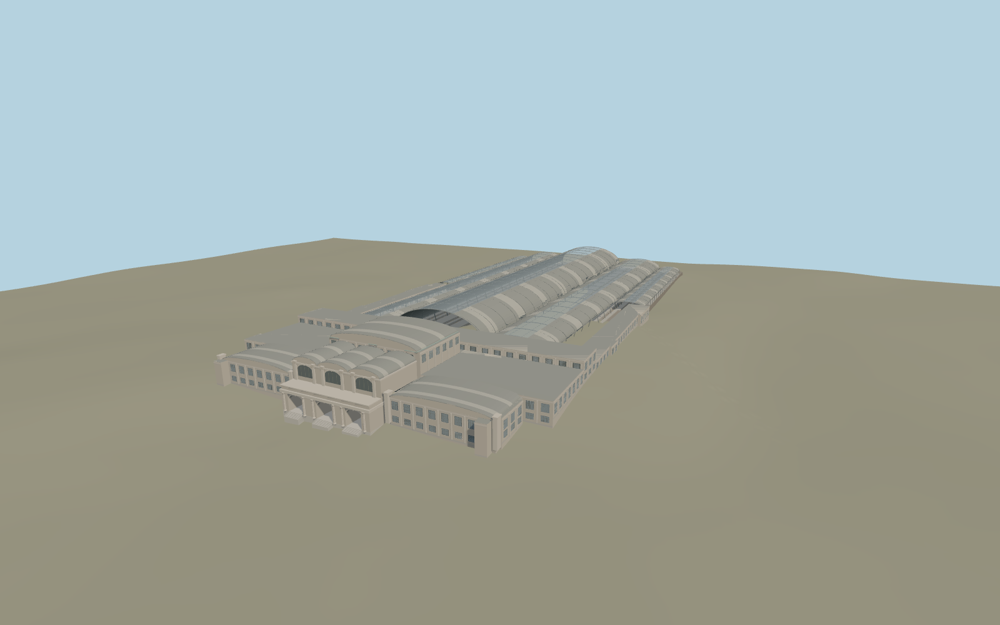

# Milano Centrale railway station

Milano Centrale faces Piazza Duca d’Aosta with a pale limestone portico, three open entrance bays and a taller barrel-roofed concourse. Five glazed train sheds shelter 24 mapped track positions and a raised deck of boarding platforms.

Run `node packages/worldgen/scripts/generate-milano-centrale-station.mjs` to rebuild the source master. Append `--check` to compare the exact bytes. Use `--ids=milano_centrale_railway_station` for targeted import, LOD generation and placement.

The station relation supplies the principal walls and shed footprints. PMTiles stop positions, platform edges, and rail centerlines control the raised platforms and tracks.

The deck grade, canopy profiles, façade carving and public hall arrangement are exterior-photo reconstructions. The track apron tapers into the standard terrain beyond the covered sheds. Underground passages, signaling, and exact sculptural figures are outside this model.

Original geometry follows the repository license. Map data is © OpenStreetMap contributors under ODbL-1.0 via Protomaps. Terrain samples are described in terrain-grid.json. Ordinary pictures stay local and are not redistributed or used as textures. Current acceptance is recorded in qa.json.
