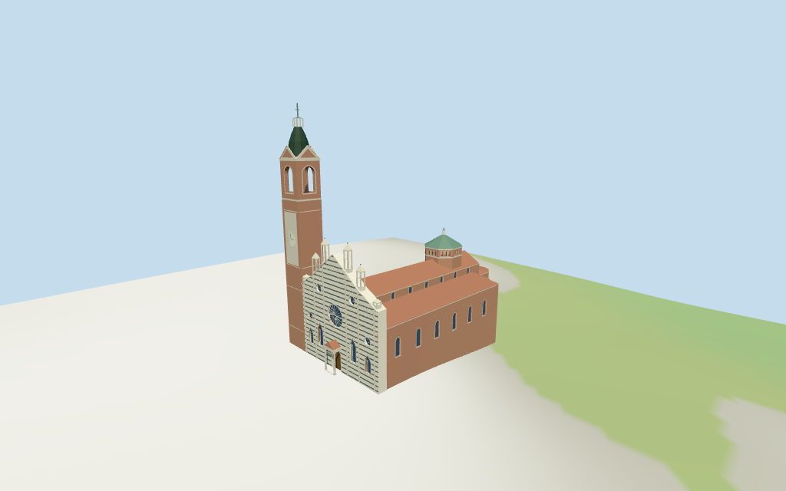

# Monza Cathedral

Individual Monza Cathedral:striped white/gray-green stepped marble screen with large rose,four oculi,pointed lights,deep central protyrus and six open Gothic pinnacles;brick long church/side envelope and red tiled roofs,green-roofed octagonal crossing loggia/lantern and northwest brick campanile with clock,open belfry,pediments,dark cap/lantern/finial.Shared textures/four medium-fi LODs.Northern museum/sacristy and surrounding town blocks remain host content.Fine sculpture/glass art/interiors and exact ground joins excluded or approximate.

## Evidence and reconstruction

Published dimensions and reconstructed details are separated in spec.json. Primary references:

- [Reference](https://commons.wikimedia.org/wiki/File:MB-Monza-Duomo-facciata-a-vento-campanile-tiburio.jpg)
- [Reference](https://commons.wikimedia.org/wiki/File:Monza,_Duomo.jpg)

Six existing256-square brick,ashlar,continuous limestone,ceramic tile,standing-seam metal and plain wood graphs serve seven merged groups.The white/gray-green facade stripes share the same ashlar graph and differ by linear vertex tint.Metric UVs,flat architectural normals,no embedded images,private facade maps,photo textures or baked lighting.

## Model and axes

13,953 triangles; 41,859 vertices; 7 material groups; 1,678,588 bytes. Native bounds: -27.400, -4.975, -27.959 to 52.408, 79.550, 16.741. Source hash: `sha256:a7a0e3036003fe98c61b4488738c7cc9728f540069f49a00973f6cc35404cd03`.

{"x":"east toward choir","y":"up","z":"south away from campanile"}

Standard viewer DEM datum169.854015 m,raw selected-control perimeter-4.63..0.89 m.Estimated floor0.55 m;footings crossY=0 and extend below samples.No flattening,host DEM change or road replacement.Exact plaza/door joins,base clipping,absolute altitude and walking unverified.

## Reproduce

Run `node packages/worldgen/scripts/generate-additional-landmarks.mjs --ids=monza_cathedral` (or add `--check`). The generator preserves manually edited masters by checking their baseline hashes. Import through the standard authored-model workflow with optimization disabled; then capture all QA cameras, including shared-surface views.

## Pending work

- The earlier reference-only record had no mapped geometry or direction. Current PMTiles whole35184421893277 and its same-ID multilingual POI Monza Cathedral/Duomo di Monza identify the main footprint at the retained reference anchor. Northwest tall campanile,western Piazza del Duomo and photographs sign the western front. Heading0.06016824725424221 rad derives from the whole western edge;no exact Wikidata-tagged way match is asserted. All124 raw points/properties in16 current whole/part controls retained without horizontal rescale.
- Raw low-body18 m,main roof27 m,full front28 m,middle front32 m,central front36 m and facade pinnacles27/35/40 m are retained. Interpret these as lower eave18 m,main ridge27 m,stepped facade envelope and respective pinnacle tips. Raw campanile62 m,inner crown72 m and lantern75 m fix the staged envelope;lower shaft50 m,belfry50..62 m,pediments66.5 m,cap72 m and lantern75 m are picture-led partitions,with an estimated79 m final finial. Crossing35 m part controls the green hip tip above estimated30.8 m loggia;its small lantern/finial37.5 m is estimated. Floor0.55 m,door/rose/archbay/roof/chapel splits and part datums remain approximate.No independent dimension facts or horizontal rescale.
- Standard viewer DEM datum169.854015 m,raw selected-control perimeter-4.63..0.89 m.Estimated floor0.55 m;footings crossY=0 and extend below samples.No flattening,host DEM change or road replacement.Exact plaza/door joins,base clipping,absolute altitude and walking unverified.
- Medium-fi exterior from two inspected Commons pictures and standard viewer PMTiles/DEM only.Hidden roof/chapel partitions and all internal stage datums remain approximate.Fine carved figures,tracery detail,inscriptions,glass art,freestanding plaza column,full interiors/bells and engineering excluded or simplified.Neighboring museum/sacristy and town blocks remain host content.No exact Wikidata-way identity,ground joins,absolute altitude,current finish or physical-device timing approval.
- Skyline retains stepped front and six pinnacles,tall open-belfry campanile,green crossing cap and red-roofed irregular body with averaged facade courses.District adds shared texture courses,front apertures,clock and framed belfry/loggia.Street adds rose spokes,pointed tracery,reveals,pilasters,cornices and clerestory.Closeup/master refine sparse upper blind arcades,clock ticks and trim;sculpture remains abstract.

This bundle follows the medium-fi standard. Medium-fi appearance and geographic fit are reviewed separately. Hash-bound visual acceptance is recorded separately after capture inspection.

## Additional geographic data

©OpenStreetMap contributors;Protomaps;Mapzen/USGS terrain tiles.
