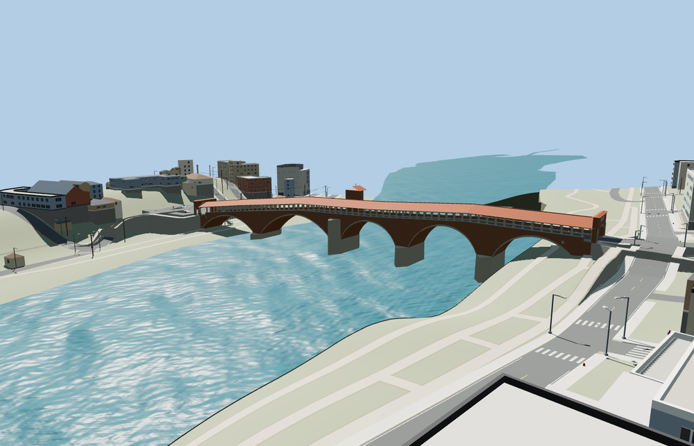

# Ponte Coperto, Pavia

**Viewer readiness passed: one original candidate, two required placed members.**

Five unequal open masonry arches, four cutwater piers, the chapel supported on the near-central pier, granite colonnades, open timber trusses, tiled roof and two three-opening portals. The separate mapped western bank stairs descend through three return flights to the retained bank path. The retained184.52m covered-body extent is not stretched to the reported216m overall length.

Preserved assembly source: 14632 triangles, 1239248 bytes. Four independently streamed levels per member; combined initial skyline plus district 352508 bytes. Main tiers950 /2936 /10412 /12932 triangles; stair tiers186 /576 /1044 /1044. All13 GLBs validate with zero errors, warnings and embedded images. Six existing material graphs are resolved once for both members.

All four native tiers pass36 width-distributed joins,23 approach checks, six model-interface contacts, six road/pedestrian portal probes and six lower-route probes. Minimum lower-route headroom across tiers is 2.880m; pedestrian portal headroom is at least2.75m. Both lower routes remain unchanged and unprofiled. The chapel replaces exactly its own mapped building;164 neighboring buildings and every independent road remain. Standard terrain and three river features, including two linear ribbons, remain unchanged. All four tiers unload geometry; failed loading preserves the native fallback.

61 current views inspected:17 portable and44 native. Main and stair each have17 exposed-side distance/light/quality/LOD/silhouette frames; detailed native views show portals, trusses, chapel and all stair landings. The shared bridge-tail rule was corrected so stairs do not transfer upper-deck height to a lower bank. Both loading orders are covered by regression tests; all409 worldgen-earth unit tests and its build/typecheck pass.

Ordinary photos, current PMTiles and coarse standard terrain constrain an approximate exterior. The final arch/deck grades and return-flight arrangement adapt the native terrain; these are visualization fit checks, not a surveyed restoration or engineering clearance certification. Hidden foundations, inscriptions and minor fittings are simplified. Physical-device timings remain unmeasured.

Rebuild: `node packages/worldgen/scripts/generate-ponte-coperto.mjs --check`. Target `--ids=ponte_coperto` with the normal import, LOD, placement and readiness scripts. The registered source-build job recreates the assembly and both members. Bulk images remain ignored; no Git mutation or upload.
