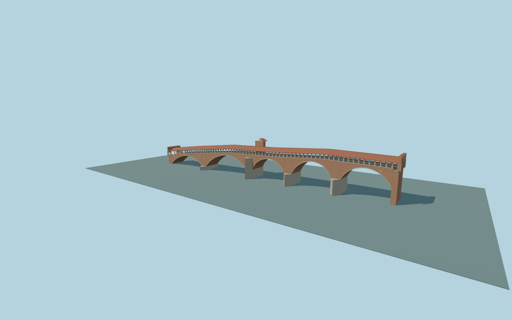

# Ponte Coperto — covered bridge and chapel

Complete covered bridge: five open masonry arches, four cutwater piers, a supported chapel in its mapped footprint, full road, raised walks, open granite colonnades, exposed timber trusses, terracotta roof and two three-opening portals.

Rebuild: `node packages/worldgen/scripts/generate-ponte-coperto.mjs`;append `--check` for exact source bytes. Select import/LOD/placement with `--ids=ponte_coperto`. Detailed source and four browser tiers are separate ignored GLB outputs.

Original ordinary-picture medium-fi exterior approximation. Individual brick courses, carving, inscriptions, roof tiles and concealed foundations are simplified; no copied image pixels, meshes, traffic or interiors.

Retained184.52m covered-body outline and reported216m crossing length remain distinct. Current PMTiles refine the deck axis; the stair return-flight layout and absolute levels adapt the unchanged coarse standard terrain. Not a surveyed engineering model.

Current native contacts, water, independent routes and all required visual/LOD review remain pending. This draft is not a readiness approval; physical-device timings remain unmeasured.

Original geometry:repository license. Map:© OpenStreetMap contributors,ODbL-1.0;Protomaps. Standard terrain:terrain-grid.json. Ordinary pictures stay local and are not redistributed or used as textures. Current acceptance:qa.json.
