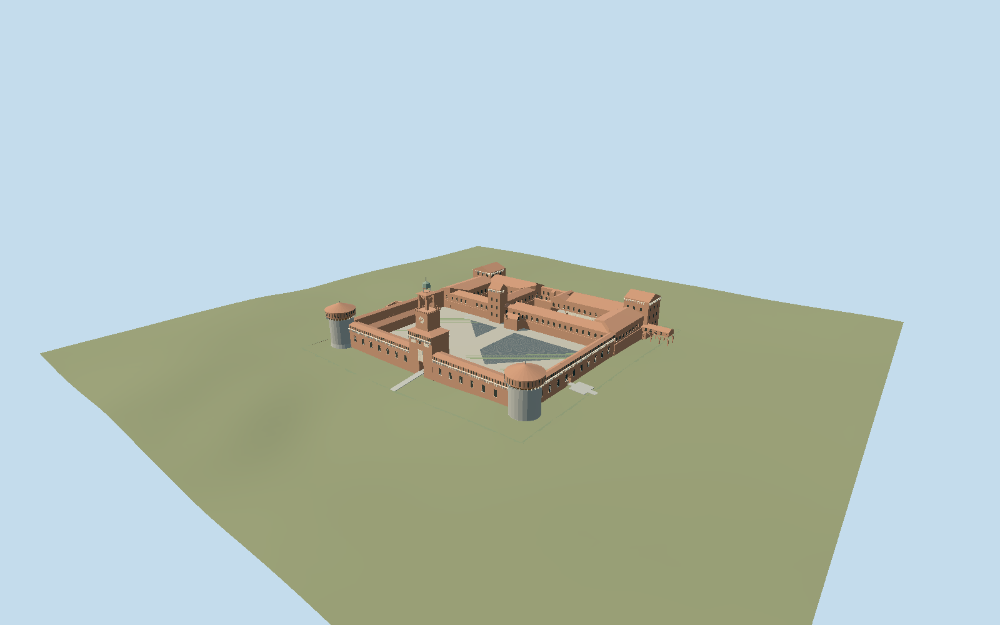

# Sforza Castle

Mapped Milan castle compound: Filarete clock tower and lantern, rough stone round city towers, square park towers, Torre di Bona, three open courts, column arcades, tiled museum ranges, wall walks, dry moat and Ponticella.

## Evidence and reconstruction

Published dimensions and reconstructed details are separated in spec.json. Primary references:

- [Reference](https://www.openstreetmap.org/relation/1918)
- [Reference](https://www.lombardiabeniculturali.it/architetture/schede/LMD80-00374/)
- [Reference](https://operanavarra.it/en/project/castello-sforzesco-milano/)
- [Reference](https://www.milanocastello.it/scopri-il-castello/torri-merlate-e-sotterranei)

No third-party geometry, photograph or bitmap texture is embedded. Shared surface graphs come from the central library; vertex tints carry model colors. Glazing uses PBR materials; transparent surfaces are declared per model.

## Model and axes

54,765 triangles; 105,979 vertices; 8 material groups; 4,477,088 bytes. Native bounds: -140.610, -3.112, -119.587 to 110.400, 71.815, 119.500. Source hash: `sha256:6c429325fbb0713999efba43150d4d1f73d073d8e64d1bbb735ec48c9e5b1e9c`.

{"up":"+Y","longitudinal":"+X toward northeast","front":"+Z toward city and Filarete gate; -Z toward park","origin":"Signed main-compound anchor; Y0 decoded127.0364 m working datum."}

Fresh Q23354 relation1918 v38 and every saved compound/building-part/bridge/pool vertex agree within0.000681 m; no missing parts. Signed heading0.746042938648 at [9.179624311,45.470327662] gives native +X northeast47.254888 degrees and +Z southeast137.254888 toward city-facing Filarete gate and round bastions. Park/square towers and rear courts are -Z; Rocchetta -X,-Z, Ducal Court +X,-Z, Ponticella projects +X,-Z. Actual regional/contractor primary photographs and compound plan sign the frame. Numeric16641-value4 m ground grid uses decoded working datum127.0364 m;3.350228 m pixel interval is not verified native resolution or survey accuracy. Court1.815 m/common architecture shift-1.185 m retain original relative dimensions. A reversible221×235 m castle-ground opening includes moat and built courts, complete floor-3.1119 m, fitted inward sides and2 m tapered perimeter aprons. It replaces only original castle-ground slab; broader park/city terrain is retained. Reconstructed moat depth4.9269 m, not a measured ditch survey. Approaches taper to adjacent numeric grade; original terrain restores on unload.

## Reproduce

Run `node packages/worldgen/scripts/generate-signature-towers.mjs --ids=sforza_castle` (or add `--check`). The generator preserves manually edited masters by checking their baseline hashes. Import through the standard authored-model workflow with optimization disabled; then capture all QA cameras, including shared-surface views.

## Pending work

- Original509200-triangle/43281340-byte detailed master remains reproducible at sha256:f5494818b50041d91b1434f110032249bec0d6a312d4eb08e5c36fbcd119faa1 from unchanged sforza-castle-model.mjs#sforzaStudy.build and map-parts.json.
- Fresh Q23354 relation1918 v38 and every saved compound/building-part/bridge/pool vertex agree within0.000681 m; no missing parts. Signed heading0.746042938648 at [9.179624311,45.470327662] gives native +X northeast47.254888 degrees and +Z southeast137.254888 toward city-facing Filarete gate and round bastions. Park/square towers and rear courts are -Z; Rocchetta -X,-Z, Ducal Court +X,-Z, Ponticella projects +X,-Z. Actual regional/contractor primary photographs and compound plan sign the frame. Numeric16641-value4 m ground grid uses decoded working datum127.0364 m;3.350228 m pixel interval is not verified native resolution or survey accuracy. Court1.815 m/common architecture shift-1.185 m retain original relative dimensions. A reversible221×235 m castle-ground opening includes moat and built courts, complete floor-3.1119 m, fitted inward sides and2 m tapered perimeter aprons. It replaces only original castle-ground slab; broader park/city terrain is retained. Reconstructed moat depth4.9269 m, not a measured ditch survey. Approaches taper to adjacent numeric grade; original terrain restores on unload.
- Four-meter diagnostic grid samples coarse public terrain;3.350228 m pixel interval is not verified native resolution or vertical accuracy. Datum/vintage and under-building contamination unknown. No outlier filter.
- Highest occupied courtyard sample plus0.25 m selects one rigid court floor; original relative building dimensions remain unchanged. The whole surrounding city/park terrain is retained.
- A bounded221×235 m castle-ground opening replaces only the original source dry-moat rectangle and court plinth. Complete moat floor at lowest sampled outer lip minus0.25 m and fitted perimeter sides close the opening; court and building foundations cover its interior. Exact ditch geometry/depth is reconstructed, not surveyed. No whole-city/hill replacement.
- Front bridge approach interpolates to retained host grade. Ponticella arches, original court proportions, approximate70 m Filarete height, roof pitches, sculpture reserves and conservations details remain medium-fi interpretations. No walkable full interior/collision/navigation or exact2026 condition survey.
- Accepted medium-fi conserved Beltrami1901–1905 reconstructed Filarete exterior: unequal tower stages, approx70 m height above court, clock, open belfry and octagonal loggia, metal cupola, open city gateway, correctly oriented courtyard trifora; two rough round bastions, three square towers, open Rocchetta/Ducal/Arms courts, museum ranges and column arcades, Ponticella supported gallery and near-view mapped Santo Spirito ravelin ruin. The ravelin height/profile is interpreted from the retained mapped plan, not a newly inspected facade. Temporary restoration scaffolding in contractor photographs is excluded. No exact2026 daily condition survey.
- Figurative Umberto I relief, S.Ambrogio statue, heraldic arms, frescoes and inscriptions remain abstract architectural reserves; detailed likeness/individual conservation scars excluded. Gate and loggia openings are real geometry, ordinary brick/rough stone/tile pattern uses shared surfaces. Exact window rhythms, rear joints, stair/under-building levels, interiors, museum objects, collision/navigation, civic fountain and wider park/city are outside scope.
- Seven reusable graphs provide gravel, brick, ceramic tile, granite, lime plaster, painted metal and patinated copper. Granite tint supplies pale architectural trim; opaque recesses/grass/water remain one local vertex-color group. Skyline bakes measured common linear means. No embedded photographs/images. Physical laptop/phone timings remain pending.

This bundle follows the medium-fi standard. Medium-fi appearance and geographic fit are reviewed separately. Hash-bound visual acceptance is recorded separately after capture inspection.

## Additional geographic data

Map data © OpenStreetMap contributors, ODbL-1.0. Original authored geometry; no reference images or third-party meshes embedded.
