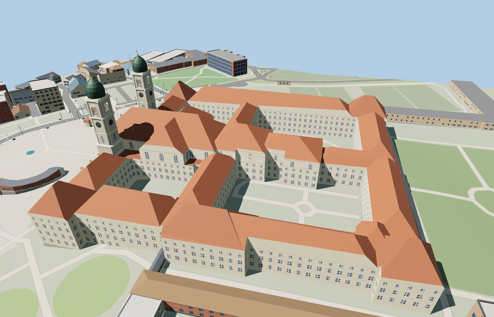

# Einsiedeln Abbey

Einsiedeln Abbey in Schwyz with the twin copper-domed towers, curved west front, tiled church and pavilion roofs, and four open courts.

The 30,903-triangle source rebuilds byte for byte. Skyline, district, street and close-up use 931, 3,414, 15,120, 30,439 triangles. The first two tiers total 358,516 bytes. Six GLBs validated and 39 current views were inspected.

All four tiers pass 22 foundation, eight open-court, seven roof, seven stair and two tower-height probes. The viewer retains 104 independent buildings, 128 mapped transportation parts. Failed loading restores all 23 original abbey features.

The abbey footprint, tower centers and four courtyards use attributed PMTiles. Roof pitches, facade opening rhythm, statuary and clock details use ordinary exterior pictures. The separate stables, fountain, crescent arcades, gardens and paths stay in their original viewer layers. The church and monastery interiors are outside this exterior model. Physical-device timings are unmeasured.

Rebuild with `node packages/worldgen/scripts/generate-einsiedeln-abbey.mjs`. Append `--check` to compare exact bytes. Use `--ids=einsiedeln_abbey` for targeted import, LOD, placement and readiness.
