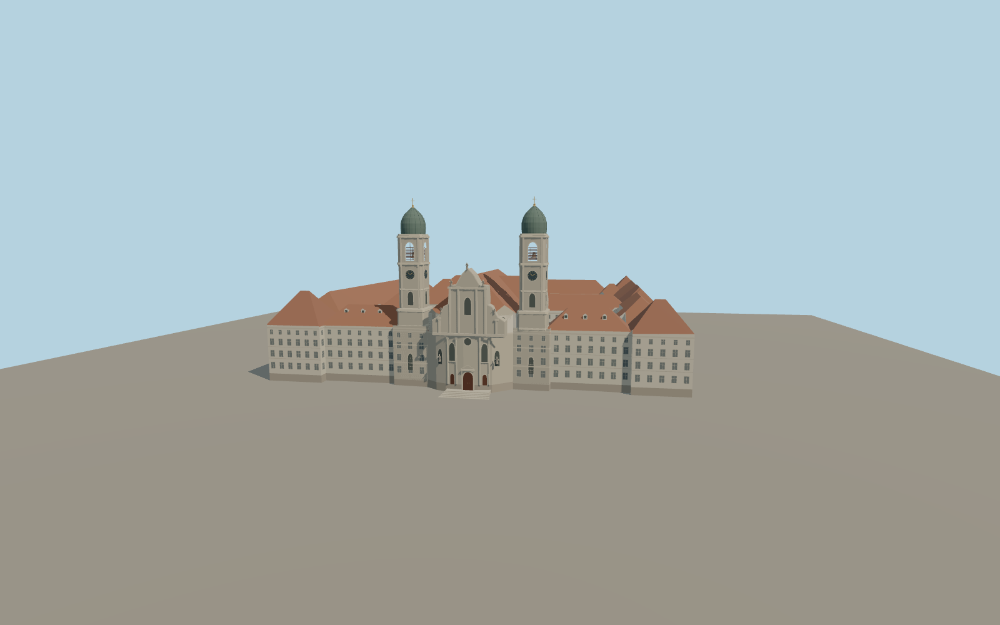

# Einsiedeln Abbey

Einsiedeln Abbey in Schwyz with the twin copper-domed towers, curved west front, tiled church and pavilion roofs, and four open courts.

Run `node packages/worldgen/scripts/generate-einsiedeln-abbey.mjs` to rebuild the source master. Append `--check` to compare the exact bytes. Use `--ids=einsiedeln_abbey` for targeted import, LOD generation and placement.

The abbey footprint, tower centers and four courtyards use attributed PMTiles. Roof pitches, facade opening rhythm, statuary and clock details use ordinary exterior pictures.

The separate stables, fountain, crescent arcades, gardens and paths stay in their original viewer layers. The church and monastery interiors are outside this exterior model.

Original geometry follows the repository license. Map data is © OpenStreetMap contributors under ODbL-1.0 via Protomaps. Terrain samples are described in terrain-grid.json. Ordinary pictures stay local and are not redistributed or used as textures. Current acceptance:qa.json.
