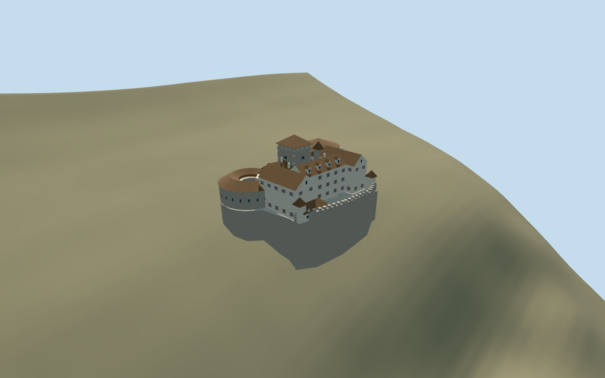

# Vaduz Castle

Present-day Vaduz Castle: square stone keep with pyramidal tile roof, roofed southern roundel with timber hoarding, open northern roundel, cream valley-facing residence and red/white shutters.

## Evidence and reconstruction

Published dimensions and reconstructed details are separated in spec.json. Primary references:

- [Reference](https://www.vaduz.li/en/living-environment/living-building/listed-buildings/schloss-vaduz)
- [Reference](https://schloss-vaduz-erleben.li/en/)
- [Reference](https://historisches-lexikon.li/Vaduz_%28Schloss%29)
- [Reference](https://historisches-lexikon.li/Datei:Schloss_Vaduz_Modell_MA.jpg)
- [Reference](https://www.openstreetmap.org/relation/1252853)

No third-party geometry, photograph or bitmap texture is embedded. Shared surface graphs come from the central library; vertex tints carry model colors. Glazing uses PBR materials; transparent surfaces are declared per model.

## Model and axes

6,623 triangles; 19,869 vertices; 5 material groups; 797,996 bytes. Native bounds: -39.100, -15.506, -29.750 to 38.000, 35.500, 27.500. Source hash: `sha256:0a45fd31a960cefa9b3632510fb72eb73b50c70559a13d91dead39298eeb0b82`.

{"up":"+Y","longitudinal":"+X north, about1.23degrees east of true north","front":"-Z west toward Vaduz and Rhine valley","origin":"Site anchor; Y0 PMTiles working datum."}

Appearance checked against two aerial pictures; signed north-south orientation distinguishes covered south roundel from open north roundel. Standard viewer Protomaps/Mapzen PMTiles set location and hillside fit at anchor 9.52434566,47.139574837 and heading 1.549323723192. Y0 is the working terrain sample 563.3922911400916m; reconstructed court10m above it clears the coarse hillside and bounded foundations extend below sampled ground. Exterior walls and floors are approximate, not surveyed.

## Reproduce

Run `node packages/worldgen/scripts/generate-signature-towers.mjs --ids=N0269` (or add `--check`). The generator preserves manually edited masters by checking their baseline hashes. Import through the standard authored-model workflow with optimization disabled; then capture all QA cameras, including shared-surface views.

## Pending work

- Reference pictures plus standard viewer PMTiles define an approximate current exterior fit. No bespoke sources or survey accuracy.
- Detailed original Vaduz geometry is preserved; only its courtyard capture camera is raised to clear the revised court. Reviewed derivative keeps its architecture, changes working vertical datum and extends bounded foundations.
- Roundels, stone keep, tiled roofs, timber hoarding and cream residence provide identity. Window/shutter rhythm, individual roof pitches and outer curtain remain approximate.
- Coarse PMTiles terrain does not resolve thresholds, narrow passages or exact cliff contact. No terrain cutout, interiors, forest or artificial hill is claimed.
- Four reusable material graphs plus local opaque glass; no embedded textures. Physical laptop/phone timing and continuous-motion shimmer remain pending.

This bundle follows the medium-fi standard. Medium-fi appearance and geographic fit are reviewed separately. Hash-bound visual acceptance is recorded separately after capture inspection.

## Additional geographic data

© OpenStreetMap contributors, ODbL-1.0. Official municipal/tourism images and the Amt für Kultur architectural research model used as references.
