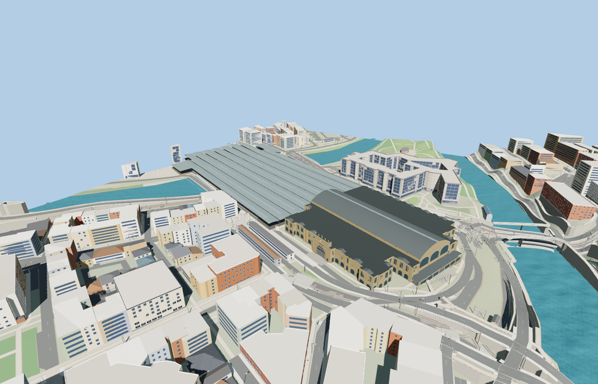

# Zürich Hauptbahnhof

The Bahnhofplatz clock pavilion and sandstone arcades frame the historic Zürich station. The barrel-roofed concourse carries iron roof trusses, clerestory arches and the four-sided hall clock. Nine platform shelters step across the westbound rail fan.

The 37,351-triangle source rebuilds byte for byte. Skyline, district, street and close-up use 948, 3,954, 15,837, 30,421 triangles. Skyline and district total 396,216 bytes. Six GLBs validated and 38 current views were inspected.

The model replaces 19 mapped station parts and preserves 331 surrounding buildings and 1198 transportation records. All four tiers pass checks for nine open doorway samples, four hall passages, nine platform roofs and decks, sixteen rail passages and four surrounding terrain samples. Ground, water and landcover restore on unload.

The historic wings, main hall, west shed and centerlines use PMTiles plan geometry. Window, truss, roof and architectural sections are reconstructed from the photos. Terrain supplies approach elevations. The interior concourse and rail bed heights are reconstructed from standard terrain samples and visible station connections. The model represents the public ground-level concourses and western train hall. Underground tracks, shops, interiors beyond the public hall and moving trains are outside its scope.

Rebuild with `node packages/worldgen/scripts/generate-zurich-hauptbahnhof.mjs`. Append `--check` to compare exact bytes. Use `--ids=zurich_hauptbahnhof` for targeted import, LOD, placement and readiness.
