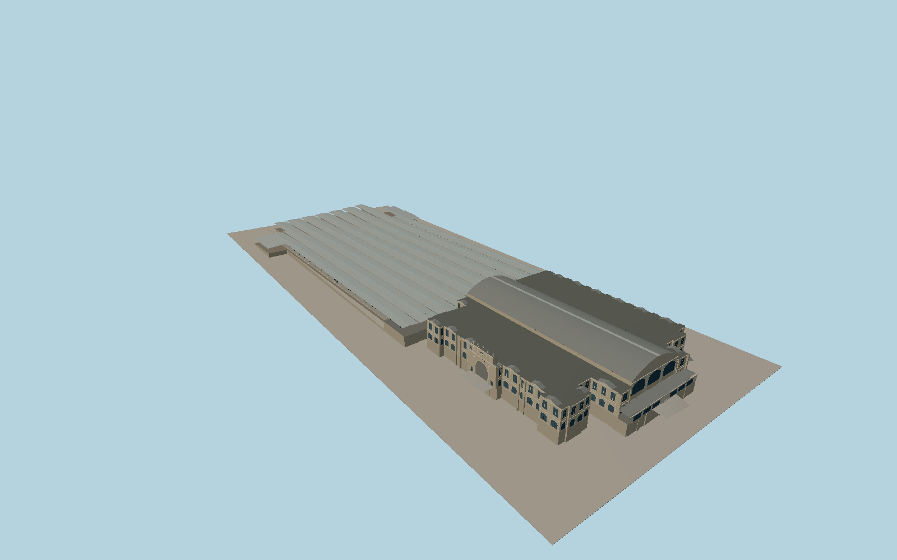

# Zürich Hauptbahnhof

The Bahnhofplatz clock pavilion and sandstone arcades frame the historic Zürich station. The barrel-roofed concourse carries iron roof trusses, clerestory arches and the four-sided hall clock. Nine platform shelters step across the westbound rail fan.

Run `node packages/worldgen/scripts/generate-zurich-hauptbahnhof.mjs` to rebuild the source master. Append `--check` to compare the exact bytes. Use `--ids=zurich_hauptbahnhof` for targeted import, LOD generation and placement.

The historic wings, main hall, west shed and centerlines use PMTiles plan geometry. Window, truss, roof and architectural sections are reconstructed from the photos.

Terrain supplies approach elevations. The interior concourse and rail bed heights are reconstructed from standard terrain samples and visible station connections.

The model represents the public ground-level concourses and western train hall. Underground tracks, shops, interiors beyond the public hall and moving trains are outside its scope.

Original geometry follows the repository license. Map data is © OpenStreetMap contributors under ODbL-1.0 via Protomaps. Terrain samples are described in terrain-grid.json. Local photographs serve as visual references for the authored geometry. Current acceptance is recorded in qa.json.
