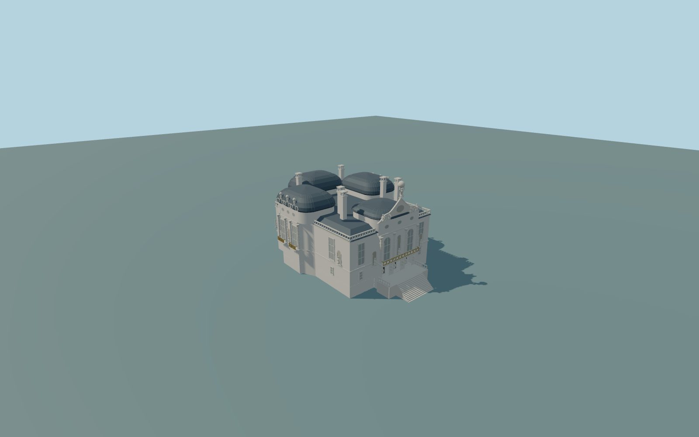

# Linderhof Palace

Complete principal palace exterior:actual irregular four-sided footprint,narrow south triple-entry range,broad north projection,two side pavilions,closed crossing roofscape and dark curved metal mansards,roof balustrades/chimneys,upper windows/pilasters/niches,gilded balcony rail cues,scroll gables/urns and original Atlas/globe/herm/statue cues. Include structural front terrace and native-grade adapter stairs. Full park/cascades/pools/follies,detached neighbors and optical interiors excluded.

Rebuild: `node packages/worldgen/scripts/generate-linderhof-palace.mjs`;append `--check` for exact source bytes. Select import/LOD/placement with `--ids=linderhof_palace`. Detailed source and four browser tiers are separate ignored GLB outputs.

Complete principal palace exterior:actual irregular four-sided footprint,narrow south triple-entry range,broad north projection,two side pavilions,closed crossing roofscape and dark curved metal mansards,roof balustrades/chimneys,upper windows/pilasters/niches,gilded balcony rail cues,scroll gables/urns and original Atlas/globe/herm/statue cues. Include structural front terrace and native-grade adapter stairs. Full park/cascades/pools/follies,detached neighbors and optical interiors excluded.

Use the actual irregular30.096x24.926m principal outline with north/south and both side projections. No current sky-open court. Actual palace4 only;do not swallow nearby long park terrace/wall polygons.

No reliable native height tags. Original photograph-proportional levels at retained plan scale:floor2.2m above963m rounded global datum,lower-storey top5.2m,main cornice11m,attic13.4m,curved roofs up to16.4m and original Atlas/globe cue20m. These are approximate envelopes,not surveyed heights. Unmodified coarse field requires structural foundations/front terrace and an explicitly original stair adapter;exact historic grades are unmeasured.

Original photo/map exterior interpretation. Fine roof junctions,sculpture/gable/urn/crest/window/chimney inventory and vertical dimensions approximate. Atlas/herms/statues/reliefs are simplified original medium-fi cues,not sculpture replicas. Closed backing behind three shallow front portals and opaque window panes exclude optical interiors. One unchanged129x129/2m field covers256m at963m datum. Floor2.2m and structural foundations/terrace/stairs adapt to that coarse field;exact historic threshold/accessibility grades not surveyed. No park/fountains/pools,cascades/temple/grotto/follies or independent buildings included. Physical phone/laptop timings unmeasured.

Six existing256px plaster,limestone,painted metal,copper,window-grid andpainted wood graphs;metric UVs andlinear vertex colors,no private/new/embedded images or copied sculpture/lettering. Seven roof/body forms include the broad north/narrow south projections and side pavilions. Original Atlas/globe,herm/niche figures,scrolls/crest/urns and balcony filigree are simplified cues,not replicas. Source preserves denser roof curves,seams,columns,rails/figures. Far omits subpixel windows/chimneys/rails and keeps main sculptural/roof silhouette and three recessed portals. District aggregates curves/rails and closes chimney vents;street reduces ornament;close-up retains denser curves/arches/rail loops. Error estimates2/1/.5/.2m are not measured mesh distances. Physical laptop/phone/dense-city timings unmeasured.

Original geometry:repository license. Map:© OpenStreetMap contributors,ODbL-1.0;Protomaps. Standard terrain:terrain-grid.json. Ordinary pictures stay local and are not redistributed or used as textures. Current acceptance:qa.json.
