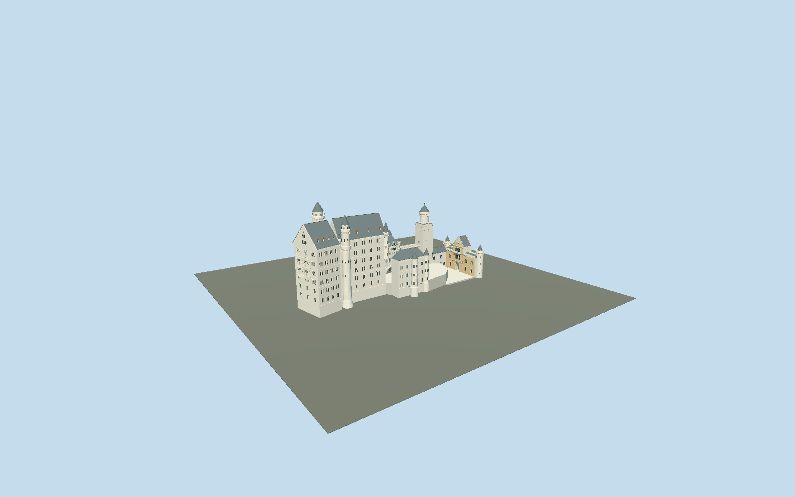

# Neuschwanstein Castle

Individually arranged cranked Palas and Throne Hall, unequal spiral stair towers, open galleries, paired Romanesque windows, copper dormers, Bower, Knights’ House, Square Tower and red-brick/yellow-stone gatehouse around two open courts.

## Evidence and reconstruction

Published dimensions and reconstructed details are separated in spec.json. Primary references:

- [Reference](https://www.neuschwanstein.de/englisch/palace/history.htm)
- [Reference](https://www.neuschwanstein.de/englisch/palace/index.htm)
- [Reference](https://www.neuschwanstein.de/bilder/schloss/grundriss790.png)
- [Reference](https://commons.wikimedia.org/wiki/File:Schloss_Neuschwanstein_2013.jpg)
- [Reference](https://commons.wikimedia.org/wiki/File:Aerial_image_of_Neuschwanstein_Castle_(view_from_the_northwest).jpg)
- [Reference](https://commons.wikimedia.org/wiki/File:Schloss_Neuschwanstein_im_November_2020_(9).jpg)
- [Reference](https://commons.wikimedia.org/wiki/File:Neuschwanstein_pano1.jpg)
- [Reference](https://commons.wikimedia.org/wiki/File:Neuschwanstein_pano2.jpg)
- [Reference](https://www.openstreetmap.org/way/221601969)

No third-party geometry, photograph or bitmap texture is embedded. Shared surface graphs come from the central library; vertex tints carry model colors. Glazing uses PBR materials; transparent surfaces are declared per model.

## Model and axes

58,313 triangles; 119,487 vertices; 8 material groups; 5,005,812 bytes. Native bounds: -75.894, -7.000, -20.800 to 64.700, 65.000, 26.050. Source hash: `sha256:d70ed386c9739982a3e43b68f16cb31edb67039a96c13edea006dd705cac7080`.

{"up":"+Y","longitudinal":"+X from western Palas toward eastern gatehouse","front":"+Z toward the southern Marienbrücke view","origin":"Signed OSM precinct frame;Y0 is the photographic Palas structural datum, with embedded foundations toY-7 and lower-court terrain contact atY1."}

The geographic proposal uses exact-QID OpenStreetMap evidence. Map-derived orientation and estimated architectural details require real-site visual review; preview eligibility is distinct from geographic/fidelity approval. Map attribution: © OpenStreetMap contributors, ODbL-1.0.

## Reproduce

Run `node packages/worldgen/scripts/generate-signature-towers.mjs --ids=neuschwanstein_castle` (or add `--check`). The generator preserves manually edited masters by checking their baseline hashes. Import through the standard authored-model workflow with optimization disabled; then capture all QA cameras, including shared-surface views.

## Pending work

- The detailed 20017068-byte234177-triangle original master remains independently reproducible at sha256:c78849de7780d2383656cb12873fabfc55a14e03a6ec92bc96be18d2d7ed3c8f from packages/worldgen/scripts/neuschwanstein-castle-model.mjs#neuschwansteinStudy.build. A separate reviewed model repairs individual occupied ranges against fresh attributable map polygons, including unequal stair towers, cranked Palas, open western galleries, dormers, Bower, Knights House, Square Tower, two open raised courts, connecting range and brick/ochre gatehouse with a genuinely open vaulted entry. Six common limestone, slate, painted metal, wood, copper and brick graphs use vertex tint; limestone is also a deliberately approximate common grain for carved/weathered and yellow gate stone, without claiming sandstone-specific bonds. Opaque glass/recess bring the near draw count to eight; no embedded images. Skyline uses baked common-graph linear means, district omits carved reveals and collapses fine paired openings, street/close retain framed arched windows and coarser circular roofs/crowns. Palas eave41.5/ridge54.5, stairs65/59.2, upper/lower courts8.2/1.0 and gate28.4 are photo-fitted working architecture; the7.2m open-court step is independently confirmed by public DGM1 heights and the relative arrangement by owner sections. OSM height65 for north stair is independent map evidence, not a surveyed datum. Murals, sculpture, animals, heraldic relief and exact carving/tracery remain schematic or omitted; no visitor interiors, mountain mesh, forest, terrain, unbuilt keep/chapel or reference photograph textures. Gate vault, precinct edges and footprint approximations are not restoration-survey accuracy. Physical phone/laptop timings remain unmeasured. Embedded foundations extend toY-7; the lower-court terrain reference usesY1. Three-metre bare-earth sampling verifies a7.2m upper/lower step, not precise foundation or restoration-survey geometry. Host terrain must retain that profile; coarse Mapzen terrain remains unsuitable for local contact. No absolute elevation is forced at runtime. A reversible court-only ground cutout prevents small DEM interpolation bumps from protruding through paving; it does not flatten or supply surrounding terrain.

This bundle follows the medium-fi standard. Medium-fi appearance and geographic fit are reviewed separately. Hash-bound visual acceptance is recorded separately after capture inspection.
