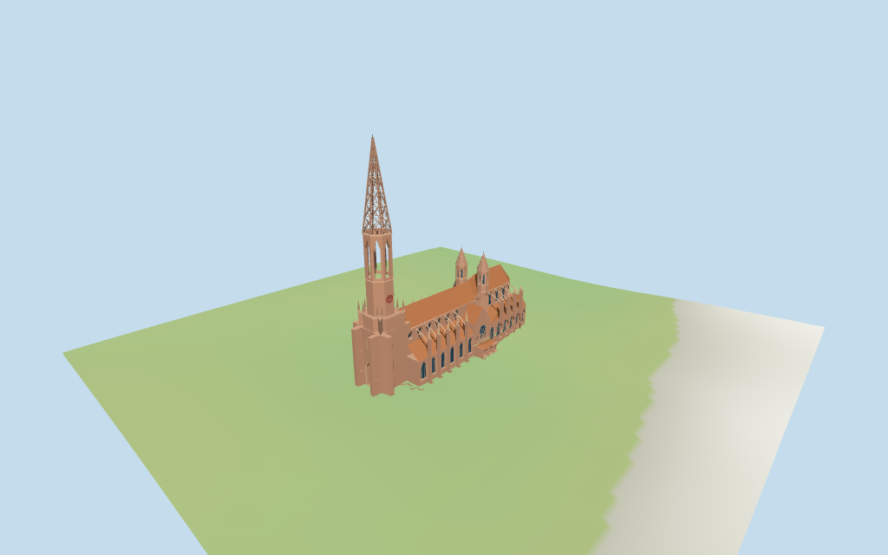

# Freiburg Minster

Individual Freiburg Minster: single stepped west tower with recessed pointed portal, red/white geometric clocks, open octagonal belfry and porous stone lattice spire; long red-tiled nave and higher polygonal east choir/chapel ring, large pointed aisle/clerestory glazing, geometric tracery, flying buttresses and pinnacles. Distinct Romanesque transept rose/round windows and low Renaissance arcade; two smaller eastern cock turrets with stone cones. Shared sandstone/ashlar/tile/wood, linear tints and metric UVs. Standard terrain foundations; no global flattening. Exact sculpture/reliefs/inscriptions, stained-glass art, tiny tracery/crockets, scaffolding, market stalls/town, surveyed paving/steps, full interiors and certified walking excluded.

## Evidence and reconstruction

Published dimensions and reconstructed details are separated in spec.json. Primary references:

- [Reference](https://commons.wikimedia.org/wiki/File:M%C3%BCnsterturm_Freiburg_20230106.jpg)
- [Reference](https://commons.wikimedia.org/wiki/File:Freiburger_M%C3%BCnster_vom_Schlossberg_3.jpg)
- [Reference](https://commons.wikimedia.org/wiki/File:Freiburg-Muenster-20-Suedseite-2007-gje.jpg)

Four existing shared256-square sandstone/ashlar/flat tile/wood graphs. Stone lattice spire and walls share sandstone; linear tints, metric UVs and flat normals. Glazing, clocks and accents use geometric flat PBR colors. No embedded images, bespoke textures or baked shadows.

## Model and axes

22,326 triangles; 66,978 vertices; 6 material groups; 2,682,748 bytes. Native bounds: -62.778, -0.930, -21.572 to 62.525, 116.400, 21.051. Source hash: `sha256:980c1635b09550d14fa50a68acb5dc7935ad136538fe3846def47e5a34f64b7b`.

{"x":"east-northeast toward polygonal choir","y":"up","z":"south-southeast"}

Standard DEM datum 280.811636m; display offset 0.4m, mapped perimeter terrain -0.58..1.86m. Foundations follow retained viewer terrain; entry estimates use local DEM+0.22m. Coarse DEM does not certify absolute altitude, Münsterplatz paving/ramps/steps, exact doorway levels, cut-fill, interiors or walking. No global terrain flattening.

## Reproduce

Run `node packages/worldgen/scripts/generate-additional-landmarks.mjs --ids=N0367` (or add `--check`). The generator preserves manually edited masters by checking their baseline hashes. Import through the standard authored-model workflow with optimization disabled; then capture all QA cameras, including shared-surface views.

## Pending work

- Exact-QID way110404213/Q250212 matches current main35184482493045. All36 main/part controls retain their raw plans/tags and min_height values or absences, without rescale. Main/west octagon height116m agrees with retained116m fact. Western base30m, transition min_height30m/height37m, octagon min_height37m/height116m, nave35m, choir/apse38m, aisles20m, transept26m, chapel ring14m, twin cock turrets53m, buttress strips29m/26m and small6.5/7/4m ranges are approximate full envelopes, not stacked walls. Estimated eaves nave26m/choir28m/aisles13m/transept18m, low roof joins20m/18m, west octagon solid37..54m/open belfry54..75m/lattice spire75..114.8m/finial116m, and small turret bodies30..43m/cones53m subdivide these controls. Flying strips guide actual outer piers/arches rather than full-width29m wall slabs. Derived Boolean inputs round to0.1mm, raw controls remain untouched. Small chapel roof slopes, fenestration, portal depths and carved profiles are picture approximations.
- Standard DEM datum 280.811636m; display offset 0.4m, mapped perimeter terrain -0.58..1.86m. Foundations follow retained viewer terrain; entry estimates use local DEM+0.22m. Coarse DEM does not certify absolute altitude, Münsterplatz paving/ramps/steps, exact doorway levels, cut-fill, interiors or walking. No global terrain flattening.
- Medium-fi exterior from three inspected useful pictures and standard PMTiles/DEM only. Exact sculpture, reliefs/inscriptions, stained-glass art, smallest tracery/crockets, temporary scaffolding, market stalls/town, surveyed paving/ramps/steps, full interiors and certified walking excluded. Rose windows are geometric flat disks/tracery rather than accurate stained glass. Physical device timing pending.
- Skyline retains the porous main spire, open coarse belfry, stepped tower, nave/choir/low ranges and twin turrets. District adds shared surfaces, flat facade fields, clocks and coarse flying arches. Street adds real facade recesses, portal/arcade cavities, supports/pinnacles, rose tracery and denser lattice. Closeup/master refine arch facets, lattice/roof trim and window bars. Synthetic cottage neighbors are review fixtures.

This bundle follows the medium-fi standard. Medium-fi appearance and geographic fit are reviewed separately. Hash-bound visual acceptance is recorded separately after capture inspection.

## Additional geographic data

©OpenStreetMap contributors; Protomaps; Mapzen/USGS terrain tiles.
