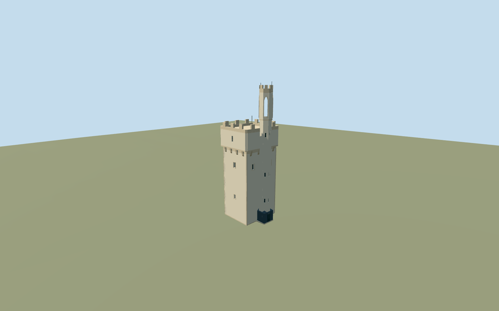
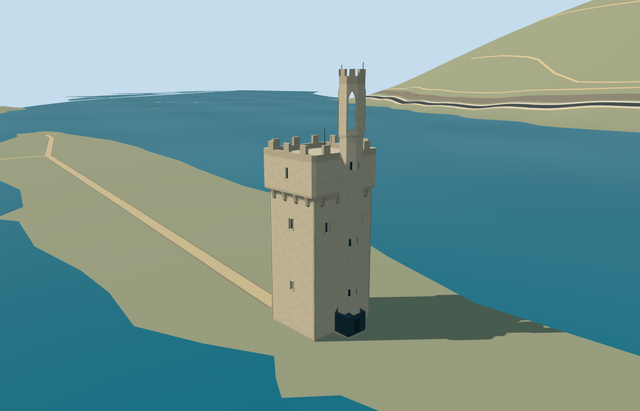

# mouse_tower — Mouse Tower

Reviewed 2026-10-20 in one continuous author/build/inspect/fix round.

## Appearance

Inspected47 current portable/shared/medium-fi/native-site frames during one ordinary-picture/map/build/inspect/fix round. The specific current pale tower retains its mapped asymmetric body/eastern projecting stair turret, quiet plaster/stone bands, truly recessed closed windows, projecting corbels/gallery, closed flat roof deck and crenellated parapet, taller octagonal shaft/pointed lancet head/closed cap/crenellated crown, sparse iron rods and dark lower housing with closed hip facets. Aligned corner pilasters to actual facade planes after initial renders showed untidy strips. Recent2026/2022 pictures set the cream finish; older2012 red trim was not copied. No observed missing roof faces or unsupported caps in the accepted views.

## Shared materials and browser levels

Four existing shared256-square graphs: stucco, stone_sandstone_raw, slate and metal_painted. Stucco supplies the pale body/turret; raw stone supplies quiet bands/frames/corbels/decks/crowns; slate supplies the small dark lower housing/cap; tinted paint supplies closed small panels and sparse iron rods. Five source roles merge into four near-level draws. Each graph is read once; eviction releases geometry. Six current GLBs contain zero embedded images/copied pixels, canonical shared refs, separate runtime position/normal buffers and equal counted CPU/GPU bytes. No new bitmap texture or model-specific photo atlas was created.

| Level | Triangles | Bytes | Draws |
| --- | ---: | ---: | ---: |
| skyline | 972 | 99176 | 1 |
| district | 2100 | 194256 | 4 |
| street | 2580 | 241488 | 4 |
| closeup | 2580 | 241488 | 4 |

Inspected24 medium-fi views at three distances, noon/late afternoon, Economy/High, neutral silhouette, matched levels and transitions. Skyline retains the unequal crowns/projecting turret/capped base housing and open upper lancets; district adds windows/corbels/rods; street and closeup share the complete restrained geometry. Levels972/2100/2580/2580triangles, initial skyline plus district293432bytes, at most four near draws. This synthetic context tests appearance, not geographic accuracy; the separate native fixture proves island/river fit. Physical laptop/phone and dense-city timings remain pending. Levels972/2100/2580/2580 triangles; at most four draws.

## Approximate map fit

Exact-QID OSMway50828644/native named building35184422917476 establish anchor7.880397636,49.972056547 and heading0/native east-south. Native quadrilateral fixes centre[-.947614693,-.057914769]m, internal X[.996129845,.087893871]/Z[-.087893871,.996129845], roughly6.8303x7.7024m main body and eastern mapped projection. The older offset reference point does not control fit. Fine facade/entry/upper opening allocation retains20degree/2m approximation. Only one corresponding shell replaced, zero residual; all77 independent resident inputs among78 originals (285 wider records), original6m terrain/native road inputs and1095604.2325103132m2 native water remain unchanged. Tower footprint overlaps native river polygons by0m2; original island holes are preserved. Failure restores78 originals and all four levels unload with zero live model geometry. No whole-island platform, ground/water cutout or river flattening was used.

## Limits

Original medium-fi exterior follows actually viewed ordinary2026/2022 current pictures, with a2012 close picture used for projection/corbel rhythm rather than its older red color scheme. Four mapped building levels/one roof level have no qualified height. Native14m is unqualified and compatible with a generic four-level body estimate; it is not treated as a measured whole-head height. Nominal main body/corbel13.4..14m, gallery/deck17.2m, main crenels18.5m, shaft19.2m, head23.8m/cap24m/crown25m and iron25.6m are explicit picture-led allocations. Hidden reverse inventory, exact window/upper-opening condition, lower housing2.63m hip cap and bounded buried footing remain approximate. The floor plane is0.079996m above coarse anchor terrain. No furnished interior, copied heraldry/text/photo atlas, neighboring Ehrenfels castle or whole-island/shore reconstruction is authored. Native shore/flood-water resolution is not a surveyed bank or flood model.

## Selected checks

Six Khronos files: zero errors/warnings.602 actual mesh/material/contact checks; 47 current inspected views. Scene validation/sim30 and strict selected medium-fi audit pass. Source/runtime/LOD hashes and material bindings verified.

Rebuild: node packages/worldgen/scripts/generate-additional-landmarks.mjs --ids=mouse_tower; node packages/worldgen/scripts/import-structure-models.mjs --ids=mouse_tower; node packages/tooling/scripts/generate-landmark-lods.mjs --ids=mouse_tower --force.

Source: sha256:6fa5a224bdd9c4971086911ca3c8bcde745fad9d6f7ce5d2807ad95461e2e266

Runtime: sha256:658f6ab22595173f5282fb0ac046bb8aea954757966a000e12ddf2bb6b26dc31

Input: sha256:31969779452a4aa6eed6cee8ed2c6bd90f7b341b312df37cee6cba2f062fea2a

## Viewed ordinary pictures

https://commons.wikimedia.org/wiki/File:Binger_M%C3%A4useturm_mit_Steint%C3%BCrmen.jpg — Luna Moonshine; CC-BY-SA-4.0. Viewed only; no pixels copied.

https://commons.wikimedia.org/wiki/File:Der_M%C3%A4useturm_bei_Bingen.jpg — Garumisalami; CC-BY-SA-4.0. Viewed only; no pixels copied.

https://commons.wikimedia.org/wiki/File:Maeuseturm_Bingen_Rhein.jpg — Arcalino; CC-BY-SA-3.0. Viewed only; no pixels copied.
