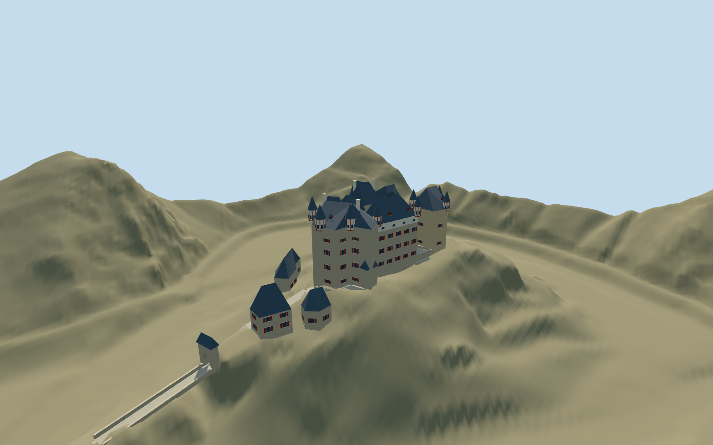

# Eltz Castle

Eight adjoining houses around a narrow open court, steep slate roofs, red-and-cream timber oriels, pale chimneys and the lower northern outer bailey.

## Evidence and reconstruction

Published dimensions and reconstructed details are separated in spec.json. Primary references:

- [Reference](https://burg-eltz.de/en/the-castle)
- [Reference](https://burg-eltz.de/en/history)
- [Reference](https://burg-eltz.de/files/Unterschriften%20und%20anderes/kernburg_lageplan.pdf)
- [Reference](https://www.openstreetmap.org/way/238981197)

No third-party geometry, photograph or bitmap texture is embedded. Shared surface graphs come from the central library; vertex tints carry model colors. Glazing uses PBR materials; transparent surfaces are declared per model.

## Model and axes

5,138 triangles; 14,478 vertices; 5 material groups; 586,120 bytes. Native bounds: -34.346, -10.752, -18.410 to 101.404, 30.137, 25.284. Source hash: `sha256:203ba5b668c8b4e71b240035fdffb6e7295a22871eaf459afb3bfdf0390837ab`.

{"up":"+Y","longitudinal":"+X north toward the outer gate","front":"+Z east","origin":"Mapped main castle; Y0 retained DGM1 working datum140.498m."}

Fresh exact way238981197 v12/Q153426 main footprint agrees within0.000719m rounding. Anchor[7.336610781,50.205058905], heading1.510444051141: +X N3.457931 degrees to north outer gate, +Z E93.457931 degrees to Coach House. Owner numbered plan, section and actual south/east/gate/court/west-aerial photographs sign frame. Fresh mapped outbuildings238981207/232357192/232357193 and bridge531706381 correct draft offsets and extend approach to27.565m. Retained official one-meter Float32 DGM1 crop in EPSG25832/DHHN2016, reference date2024-03-15 with acquisition unknown, working datum140.498m. Court1.6368m; inner gate1.2934m; north gate-7.0034m; outer bridge-8.4437m, separate outbuilding floors. Bounded foundations extend below sampled ground. No survey accuracy, full-site slab or terrain cutout.

## Reproduce

Run `node packages/worldgen/scripts/generate-signature-towers.mjs --ids=N0266` (or add `--check`). The generator preserves manually edited masters by checking their baseline hashes. Import through the standard authored-model workflow with optimization disabled; then capture all QA cameras, including shared-surface views.

## Pending work

- Original5356-triangle/606620-byte master reproduces at sha256:21a46ad8431c67f07a0f2a3a1ca066ead258597edccc2378486237d59156c474 from unchanged eltz-castle-model.mjs#buildEltzRuntime and unchanged indexed main footprint.
- Fresh exact way238981197 v12/Q153426 main footprint agrees within0.000719m rounding. Anchor[7.336610781,50.205058905], heading1.510444051141: +X N3.457931 degrees to north outer gate, +Z E93.457931 degrees to Coach House. Owner numbered plan, section and actual south/east/gate/court/west-aerial photographs sign frame. Fresh mapped outbuildings238981207/232357192/232357193 and bridge531706381 correct draft offsets and extend approach to27.565m. Retained official one-meter Float32 DGM1 crop in EPSG25832/DHHN2016, reference date2024-03-15 with acquisition unknown, working datum140.498m. Court1.6368m; inner gate1.2934m; north gate-7.0034m; outer bridge-8.4437m, separate outbuilding floors. Bounded foundations extend below sampled ground. No survey accuracy, full-site slab or terrain cutout.
- One/two-meter grids are not survey accuracy. Steep rock and terrain below buildings may be interpolated. Current terrace, court and entrance levels are reconstructed from surrounding open ground. No whole-site ground replacement.
- Working court1.6368m is0.22m above maximum sampled open court control; building floors are estimated from surrounding ground, not surveyed threshold heights.
- Bridge endpoints and paved north route follow fresh map geometry; the source DGM excludes bridges. The suspended approach uses reconstructed parapets and end supports, with no invented measured central arch.
- Outbuilding floors and widths are separately reconstructed from fresh mapped footprints and owner plans/photos. No whole-site slab, excavated ground cutout, trees, distant ruined outer ward or navigable interiors.
- Eight house ranges, irregular narrow court, red-and-cream oriels, white Rübenach band, ochre Platt-Eltz, Kempenich gable and pale chimneys retain original relative heights. Published35m towers include lower slope walls;60m rock height is terrain, not building height. Slate roofs observed in owner2011/undated photographs; ongoing restoration means individual temporary details may differ.
- Low tiers retain all principal house/outbuilding volumes, roofs and outer gate void and inner gate recess. District adds sparse openings; street/close-up add frames, timber and dormers. Roof boundaries, windows, current court/threshold heights, outbuilding identity assignments and southern retaining walls remain exterior approximations.
- Four common graphs supply sandstone, slate, wood and lime plaster; local opaque PBR glass. Skyline bakes actual common linear means into one draw. No embedded bitmap images or private texture copies. Physical laptop/phone timing and continuous-motion shimmer pending.

This bundle follows the medium-fi standard. Medium-fi appearance and geographic fit are reviewed separately. Hash-bound visual acceptance is recorded separately after capture inspection.

## Additional geographic data

© OpenStreetMap contributors, ODbL-1.0; owner plan and photographs used as linked research evidence.
