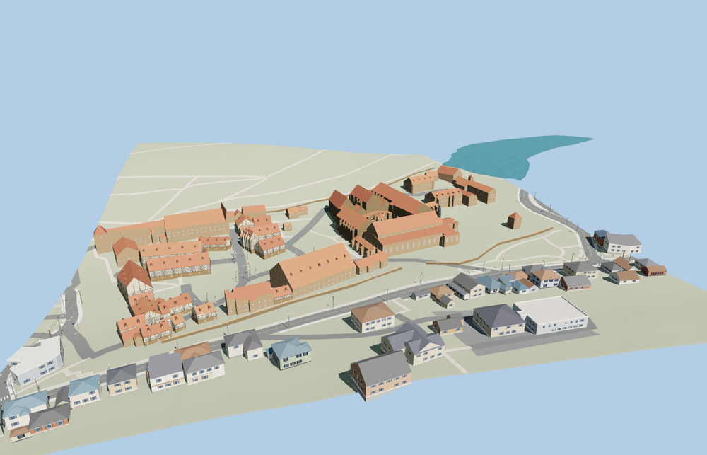

# Maulbronn Monastery

Maulbronn Monastery with the Cistercian church and ridge spire, open cloister and fountain house, west gate, Fruchtkasten granary, terracotta roofs, half-timbered courtyard houses and visible enclosure walls.

The 36,816-triangle source rebuilds byte for byte. Skyline, district, street and close-up use 924, 3,828, 12,779, 36,816 triangles. The first two tiers total 395,872 bytes. Six GLBs validated and 38 current views were inspected.

Each tier passes six foundation contacts, eight open-court probes and three west-gate passage probes. The smallest sampled gate clearance is 3.01 m. The geographic viewer preserves 121 mapped route parts, 50 independent buildings and the native terrain and water. Failed loading restores the native building footprints.

Roofs follow the mapped footprints and the height hierarchy seen in exterior photographs. Individual openings, roof pitches, the pavilion and wall portions are visual approximations. The model covers the exterior within the precinct. The church, residential interiors, vineyard terraces and historic hydraulic works are outside the modeled scope. Physical-device timings are unmeasured.

Rebuild with `node packages/worldgen/scripts/generate-maulbronn-monastery.mjs`. Append `--check` to compare exact bytes. Use `--ids=maulbronn_monastery` for targeted import, LOD, placement and readiness.
