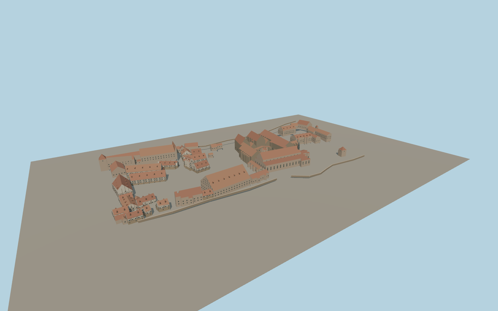

# Maulbronn Monastery

Maulbronn Monastery with the Cistercian church and ridge spire, open cloister and fountain house, west gate, Fruchtkasten granary, terracotta roofs, half-timbered courtyard houses and visible enclosure walls.

Run `node packages/worldgen/scripts/generate-maulbronn-monastery.mjs` to rebuild the source master. Append `--check` to compare the exact bytes. Use `--ids=maulbronn_monastery` for targeted import, LOD generation and placement.

Roofs follow the mapped footprints and the height hierarchy seen in exterior photographs. Individual openings, roof pitches, the pavilion and wall portions are visual approximations.

The model covers the exterior within the precinct. The church, residential interiors, vineyard terraces and historic hydraulic works are outside the modeled scope.

Original geometry follows the repository license. Map data is © OpenStreetMap contributors under ODbL-1.0 via Protomaps. Terrain samples are described in terrain-grid.json. Ordinary pictures stay local and are not redistributed or used as textures. Current acceptance:qa.json.
