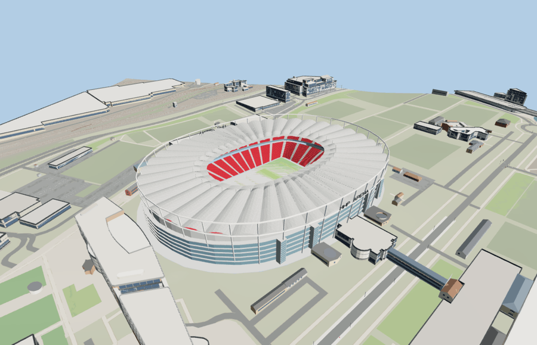

# MHPArena

The cable-supported white roof, tall asymmetric compression ring and open, lowered pitch remain visible at all four browser levels. District and closer render the 40 membrane bays. Street and close-up add the inner canopy extension and floating struts, red seating, main stand terraces, enclosed stairs and the two screens.

The exact mapped pitch axis puts Cannstatter Kurve northwest and the enlarged main stand southwest. The north plaza sets the exterior datum near 223.53 m. The native stadium cutout exposes the field about 1.3 m lower. The viewer replaces eight mapped stadium records and retains 147 nearby building records, including six distinct surrounding features, plus all 372 road records.

| Detail level | Triangles | Download bytes | Draws |
| --- | ---: | ---: | ---: |
| skyline | 994 | 83,404 | 6 |
| district | 3,194 | 253,612 | 6 |
| street | 15,578 | 1,175,540 | 6 |
| closeup | 59,206 | 4,269,392 | 6 |

The source rebuild reproduces the original 1,005,216 triangles byte for byte. The first two browser tiers total 337,016 bytes. All six GLBs use shared materials and contain zero embedded images.

A failed model load retains the mapped stadium. All four tiers release their geometry on unload. The review covers 55 captures and 110 placement samples.

The apron elevation and stair contacts are approximate. Cable sections, membrane camber and seat layouts are reconstructed from ordinary photographs.

The model covers the stadium and integrated SCHARRena exterior. Independent sports buildings and the service approaches outside the arena remain native context.

[Operator photographs and main stand](https://www.mhparena-stuttgart.de/aktuelles/neubau-der-haupttribuene-abgeschlossen/) · [Mapped terrain fit](site-fit.json) · [QA evidence](qa.json)
