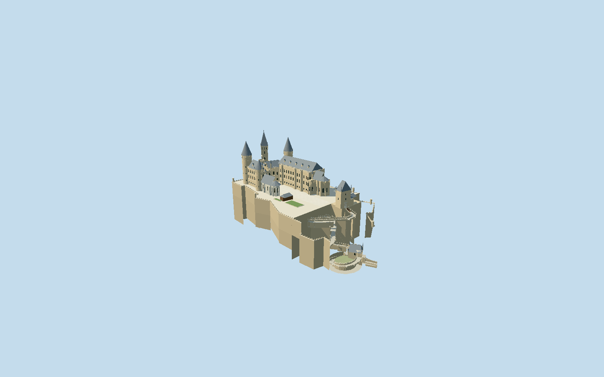

# Hohenzollern Castle

Mapped horseshoe palace and distinct Kaiser, Markgraf, Bishop, Michael and Watch towers, two separately shaped chapels, bastion ring and multilevel open entrance ramps with gate tunnels.

## Evidence and reconstruction

Published dimensions and reconstructed details are separated in spec.json. Primary references:

- [Reference](https://burg-hohenzollern.com/en/)
- [Reference](https://burg-hohenzollern.com/en/about-the-castle/ubersichtsplan-der-burg-kopie)
- [Reference](https://burg-hohenzollern.com/en/about-the-castle/castle-history)
- [Reference](https://commons.wikimedia.org/wiki/File:Colorierter_Entwurf_-_Schloss_Hohenzollern_-_St%C3%BCler.jpg)
- [Reference](https://commons.wikimedia.org/wiki/File:BurgHohenzollernInnenhof02.jpg)
- [Reference](https://www.openstreetmap.org/way/93612350)

No third-party geometry, photograph or bitmap texture is embedded. Shared surface graphs come from the central library; vertex tints carry model colors. Glazing uses PBR materials; transparent surfaces are declared per model.

## Model and axes

43,413 triangles; 95,481 vertices; 8 material groups; 3,962,856 bytes. Native bounds: -87.832, -22.705, -44.520 to 81.763, 68.744, 46.246. Source hash: `sha256:e29f4d2b22153497ccfde330a25ed08ce2419d8e8960e1d470139252921c7b62`.

{"up":"+Y","longitudinal":"+X east-southeast, 14.565 degrees south of east","front":"+X entrance; +Z south-southwest","origin":"Signed enclosure anchor; Y0 decoded 835.9281 m numeric terrain working datum."}

Fresh exact-Q156457 enclosure way 93612350 v51 and 43 mapped parts use native +X ESE at 104.564815 degrees, +Z SSW at 194.564815 degrees, heading -0.254203978258. Several shared entrance nodes changed since the original source: up to 12.203 m nearest-vertex displacement is recorded as a map-version difference. The independent derivative uses fresh geometry; original evidence and recipe remain reproducible. Eagle and upper gate passage centers/bearings follow the mapped covered roads. Retained coarse numeric terrain has a 4225-value 4 m native grid and decoded anchor working datum 835.9281 m. One rigid -10.4563 m shift meets mapped approach grade +0.08 m; court is 19.5437 m above anchor. The 30 m relative entry-to-court rise remains a reconstruction supported by independent 825/855 map tags, not a connected vertical survey. Only the lowest owned entrance roads and Eagle gate use a 434.096-square-meter ground cut; its enclosed island retains sampled grade. Upper court and mountain remain uncut. Mapped structural skirts extend four meters below retained terrain.

## Reproduce

Run `node packages/worldgen/scripts/generate-signature-towers.mjs --ids=N0252` (or add `--check`). The generator preserves manually edited masters by checking their baseline hashes. Import through the standard authored-model workflow with optimization disabled; then capture all QA cameras, including shared-surface views.

## Pending work

- Original 349299-triangle / 30044980-byte master remains independently reproducible at sha256:5cb6e4124350dee11d4dd9368b9ae214494f141b73d15c7d050fcf08c45838e7 from hohenzollern-castle-model.mjs#hohenzollernStudy.build and unchanged original map-parts.json.
- Fresh exact-Q156457 enclosure way 93612350 v51 and 43 mapped parts use native +X ESE at 104.564815 degrees, +Z SSW at 194.564815 degrees, heading -0.254203978258. Several shared entrance nodes changed since the original source: up to 12.203 m nearest-vertex displacement is recorded as a map-version difference. The independent derivative uses fresh geometry; original evidence and recipe remain reproducible. Eagle and upper gate passage centers/bearings follow the mapped covered roads. Retained coarse numeric terrain has a 4225-value 4 m native grid and decoded anchor working datum 835.9281 m. One rigid -10.4563 m shift meets mapped approach grade +0.08 m; court is 19.5437 m above anchor. The 30 m relative entry-to-court rise remains a reconstruction supported by independent 825/855 map tags, not a connected vertical survey. Only the lowest owned entrance roads and Eagle gate use a 434.096-square-meter ground cut; its enclosed island retains sampled grade. Upper court and mountain remain uncut. Mapped structural skirts extend four meters below retained terrain.
- Coarse terrain does not resolve the sharp summit, bastion feet or covered spiral entrance; exact vertical datum, native resolution and vintage remain unverified.
- One rigid shift puts the fresh mapped approach start 0.08 m above decoded grade. The existing 30 m relative court height is retained as an explicit reconstruction; independent map elevation tags 825 and 855 are not a connected survey.
- Mapped structural skirts extend below sampled terrain. A narrow connected lowest-road and Eagle-gate ground cut clears only owned civil surfaces; upper court and mountain remain host terrain.
- Accepted exterior scope includes the horseshoe palace, independent tower forms, two chapels, court, bastion enclosure and multilevel spiral entrance. The forested mountain, water tower, parking buildings, ivy, statuary, museum rooms and inaccessible casemates are separate scope.
- Normal architecture follows the official illustrated plan, historic design elevations and courtyard photograph; temporary restoration scaffolding is omitted. These are not measured current elevations. Fine facade/window counts, gate body envelopes and vault shapes remain approximate.
- Six reusable graphs provide granite, sandstone, limestone, timber, painted metal and slate. Carved trim shares sandstone with distinct tint; slate courses use the shared texture rather than copied roof geometry. Opaque PBR glass and garden tint have no images. Skyline bakes common linear means; physical phone/laptop timings remain unmeasured.

This bundle follows the medium-fi standard. Medium-fi appearance and geographic fit are reviewed separately. Hash-bound visual acceptance is recorded separately after capture inspection.

## Additional geographic data

Map geometry © OpenStreetMap contributors, ODbL-1.0. Official illustration, public-domain architect drawing and CC-BY-SA courtyard photograph are research references only; no third-party images or meshes bundled.
