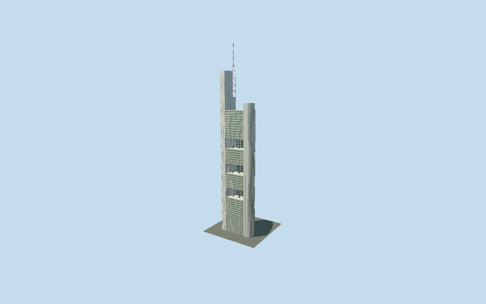

# Commerzbank Tower

Complete triangular silver/green tower with nine visible staggered garden recesses, three rounded corner cores, flat stepped crown, red/white lattice mast and independently mapped western main entrance.

## Evidence and reconstruction

Published dimensions and reconstructed details are separated in spec.json. Primary references:

- [Reference](https://find-an-architect.architecture.com/foster-partners/london/commerzbank-headquarters)
- [Reference](https://www.commerzbank.de/konzern/newsroom/pressemitteilungen/buerogebaeude.html)
- [Reference](https://www.skyscrapercenter.com/frankfurt-am-main/commerzbank-tower/780/)
- [Reference](https://www.openstreetmap.org/way/183060777)

No third-party geometry, photograph or bitmap texture is embedded. Shared surface graphs come from the central library; vertex tints carry model colors. Glazing uses PBR materials; transparent surfaces are declared per model.

## Model and axes

27,431 triangles; 82,269 vertices; 5 material groups; 3,294,016 bytes. Native bounds: -30.485, 0.000, -28.080 to 30.485, 300.000, 27.936. Source hash: `sha256:efc59898d8eb4adfa37f6a81f1eaae8587378d15706ccae1673b18e509692115`.

{"up":"+Y","longitudinal":"+X east through signed asymmetric three-core plan","front":"-X western Große Gallusstraße19 main entry","origin":"Ground contact in exactQ151765 frame"}

The geographic proposal uses exact-QID OpenStreetMap evidence. Map-derived orientation and estimated architectural details require real-site visual review; preview eligibility is distinct from geographic/fidelity approval. Map attribution: © OpenStreetMap contributors, ODbL-1.0.

## Reproduce

Run `node packages/worldgen/scripts/generate-signature-towers.mjs --ids=commerzbank_tower` (or add `--check`). The generator preserves manually edited masters by checking their baseline hashes. Import through the standard authored-model workflow with optimization disabled; then capture all QA cameras, including shared-surface views.

## Pending work

- Complete medium-fi tower includes rounded triangular base, three occupied wings around central atrium, nine staggered four-storey garden volumes, three rounded service cores, western tall flat-roof crown and red/white open lattice antenna to300m. Original54151-triangle recipe remains unchanged and reproducible. Engineer photograph and award section show flat stepped corner cores and lattice mast; reviewed source replaces the original sloping glass crown and solid mast approximation, while keeping mapped component positions. Arup publishes259m architectural height,160m atrium,nine15m gardens alternating30m offices; professional registry publishes300m tip and190m occupied height. Counts differ between architect53storeys and engineer50above-ground/45office; no literal floor-count claim. Three garden schedules and15m depth remain reconstruction using mapped coarse strata, not a surveyed schedule. Broad rounded cores use silver shared painted-metal panels and narrow reconstructed vertical dark strips; outer office curtain walls use opaque palette PBR glazing. Garden exterior transparent glass is omitted around structural bars to keep vegetation/recess readable; it is a deliberate abstraction, not literal exterior open air. Source trees are original medium-fi foliage. Named Große Gallusstraße19 entry belongs to base, receives reconstructed glazing/recess and small threshold; hardware and grade unmeasured. Separate perimeter historic block, galleria interior, neighboring restored structures, public cafés, basements and interiors are outside this tower bundle. Official award interior images support galleria context only. Exact service fittings, logos, mast lights, panel joints, plant species and garden furniture are simplified or omitted. Night illumination, real grade and physical-device performance unmeasured.

This bundle follows the medium-fi standard. Medium-fi appearance and geographic fit are reviewed separately. Hash-bound visual acceptance is recorded separately after capture inspection.
