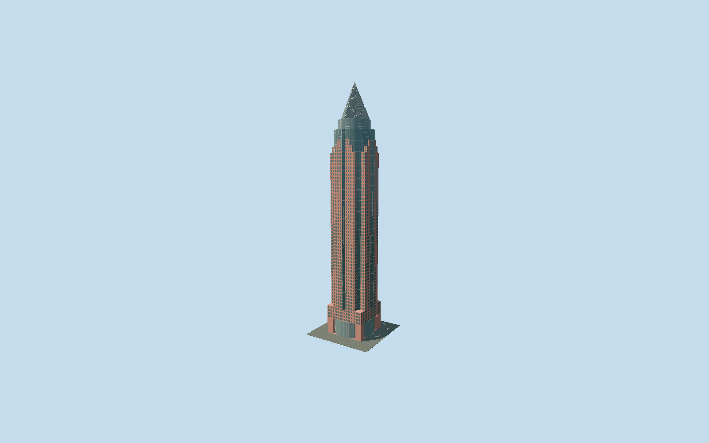

# Messeturm

Jahn’s red-granite skyscraper with four stepped steles around an exposed glass cylinder, pointed central window bays, reconstructed2022 curved-glass lobby and the distinctive three-stage diamond-oriented pyramid.

## Evidence and reconstruction

Published dimensions and reconstructed details are separated in spec.json. Primary references:

- [Reference](https://jahn.studio/work/messeturm/)
- [Reference](https://messeturm.com/en/)
- [Reference](https://messeturm.com/fileadmin/user_upload/MESSETURM_Image_Book_25082022.pdf)
- [Reference](https://www.hochtief.de/ueber-hochtief/geschichte/messeturm-in-frankfurt-am-main)
- [Reference](https://www.skyscrapercenter.com/building/messeturm/796)

No third-party geometry, photograph or bitmap texture is embedded. Shared surface graphs come from the central library; vertex tints carry model colors. Glazing uses PBR materials; transparent surfaces are declared per model.

## Model and axes

10,693 triangles; 29,851 vertices; 4 material groups; 1,205,768 bytes. Native bounds: -22.715, 0.000, -22.966 to 22.866, 256.517, 22.705. Source hash: `sha256:640453d8af034928ffeefee58e58b8bad8cdf6ec6dd8626ff002eaa2bd2c136b`.

{"up":"+Y","longitudinal":"+X northeast","front":"+Z southeast; four-sided symmetric facade","origin":"Exact-QID mapped ground-contact footprint frame"}

The geographic proposal uses exact-QID OpenStreetMap evidence. Map-derived orientation and estimated architectural details require real-site visual review; preview eligibility is distinct from geographic/fidelity approval. Map attribution: © OpenStreetMap contributors, ODbL-1.0.

## Reproduce

Run `node packages/worldgen/scripts/generate-signature-towers.mjs --ids=messeturm` (or add `--check`). The generator preserves manually edited masters by checking their baseline hashes. Import through the standard authored-model workflow with optimization disabled; then capture all QA cameras, including shared-surface views.

## Pending work

- Original31792-triangle/2977692byte detailed master remains reproducible from unchanged global recipe. Independently mapped square base, curved lobby, exposed main/upper glass cylinders, three stepped granite steles and diamond-oriented three-stage pyramid retained. CVU/contractor256.5m top; owner257rounded/41mwide/64floors/1990 versus architect251m/42mwide/63floors/1991, reported as differing publication conventions.2022lobby17m architect/15m owner foyer, curved glass18mx3m owner. Architectural officegrid3.6m owner; glazing pitch, granite-band widths, 188/194/200/210/220m setback datums from map and crown220–232/233.1–244.1/245.2–256.5m stages reconstructed from photos. Façade represented by full planes and shared tinted granite strips, finer bevels omitted in derivatives. Skyline aggregates granite windows; main shapes and bays kept. Two canonical256px granite/paintedmetal graphs shared, opaque glass; zero embedded images or photographic facade texture. Exact doors, interior furnishings, basement, Hammering Man sculpture and adjoining halls excluded. Terrain slope and physical-device/dense-city performance unmeasured. Reviewed source uses wider rose granite bands reconstructed from close architect photos, with aggregate stripe widths scaled per level to retain stone coverage. Horizontal cylinder roof caps use muted grey metal, replacing conspicuous bright original caps. Original detailed master remains reconstructible from its unchanged global recipe.

This bundle follows the medium-fi standard. Medium-fi appearance and geographic fit are reviewed separately. Hash-bound visual acceptance is recorded separately after capture inspection.
