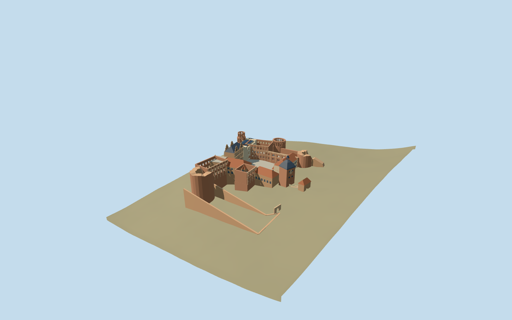

# Heidelberg Castle

Present-day red-sandstone palace ruins around an open court: restored twin-gabled Friedrich wing, roofless Ottheinrich and English wings, broken defensive towers and52m gate.

## Evidence and reconstruction

Published dimensions and reconstructed details are separated in spec.json. Primary references:

- [Reference](https://www.schloss-heidelberg.de/en/visitor-experience/castle-garden/buildings)
- [Reference](https://www.schloss-heidelberg.de/fileadmin/Broschueren/Abrissplaene/ssg_schloss-heidelberg_kunstfuehrer-lageplan.pdf)
- [Reference](https://www.schloss-heidelberg.de/wissenswert-amuesant/geschichtshaeppchen)
- [Reference](https://www.openstreetmap.org/way/254154168)

No third-party geometry, photograph or bitmap texture is embedded. Shared surface graphs come from the central library; vertex tints carry model colors. Glazing uses PBR materials; transparent surfaces are declared per model.

## Model and axes

7,655 triangles; 20,423 vertices; 5 material groups; 830,356 bytes. Native bounds: -75.590, -23.238, -75.861 to 92.799, 47.984, 105.799. Source hash: `sha256:ba8b3e32671f8f9dbaa80d25725c6d7f460597bef76d789e798a6a539e545fab`.

{"up":"+Y","longitudinal":"+X approximately south","front":"+Z approximately west","origin":"Mapped site anchor; Y0 standard PMTiles working terrain datum."}

Picture-based current exterior registered to named mapped wings and the standard Protomaps/Mapzen PMTiles viewer data. +X south toward gate, +Z west toward English wing; signed orientation retains heading-1.430862687712. Working datum187.413498859529m and reconstructed court8.3m. Bounded lower walls follow coarse PMTiles ground; bridge and outer gate use separate levels. No surveyed threshold accuracy. Bespoke DGM1 verification remains deferred at the owner request.

## Reproduce

Run `node packages/worldgen/scripts/generate-signature-towers.mjs --ids=N0267` (or add `--check`). The generator preserves manually edited masters by checking their baseline hashes. Import through the standard authored-model workflow with optimization disabled; then capture all QA cameras, including shared-surface views.

## Pending work

- Visual fit against the standard viewer PMTiles pipeline; no surveyed ground or threshold accuracy.
- Terrain data is coarse under buildings and bridges. Exact court and retaining-wall levels are reconstructed from pictures.
- Working court is reconstructed flat above the highest standard PMTiles sample within the open court; no exact historic floor level is claimed.
- Bespoke DGM1 hillside verification is deferred at the owner request.
- Original detailed master is preserved from unchanged heidelberg-castle-model.mjs#buildHeidelbergRuntime at sha256:77bfb5237eecc8345fb236d8b46393444ec611bbdf372bb565245b35b65ea180.
- Runtime derivative corrects wing positions and courtyard size, adds distinct library/Ruprecht/Ludwig volumes and the Hall of Glass arched protective roof. The dated owner aerial supplies overall proportions; scaffolding and restoration details are omitted.
- Mapped component rectangles approximate irregular footprints; roofs, floors, windows, bridge supports, western retaining walls and detached tower fragment remain reconstructions. No terrain cutout, whole-site slab, interiors, distant gardens or vegetation.
- Four shared sandstone, plaster, slate and tile graphs; local opaque glass. No copied private textures. Physical-device timing and continuous-motion shimmer are pending.

This bundle follows the medium-fi standard. Medium-fi appearance and geographic fit are reviewed separately. Hash-bound visual acceptance is recorded separately after capture inspection.

## Additional geographic data

© OpenStreetMap contributors, ODbL-1.0; owner plans and photographs used as research.
