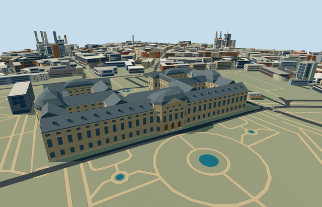

# N0771 — Würzburg Residence

Reviewed 2026-10-23. **Completed medium-fi connected exterior; approximate native terrain fit.**

## Built and inspected

The complete mapped palace retains its open western Ehrenhof and four inner courtyards. Sandstone facades, the taller central garden pavilion, slate roof subdivisions and curved outer roof masses establish the silhouette. Nearby views add three-level glazing, upper arched and oval windows, pilasters, dormers, six recessed wooden portals, four front columns on a closed apron, and two recessed six-column side loggias. Roof figures and the small verdigris turret are original simplified abstractions.

One continuous author/inspect/fix pass used three ordinary exterior photographs and standard PMTiles/Mapzen data. All **52 final frames** were inspected: 9 portable, 9 shared-material, 25 medium-fi and 9 native views. Eleven contact sheets and a full-resolution western entrance view cover the current geometry. Early inspection led to a darker slate tint, a supported apron and additional upper windows/pilasters.

## Shared materials and loading

Six roles use six existing 256px graphs: `stone_sandstone`, `stone_limestone`, `slate`, `storefront`, `wood_plain` and `metal_painted`. Metric UVs and linear tints preserve shared texture use; skyline uses graph means. There are no embedded images or private atlases. Separate POSITION/NORMAL streams have equal CPU/GPU geometry accounting. Each used graph loads once; unload releases all model geometry.

| LOD | Triangles | Bytes | Draws |
| --- | ---: | ---: | ---: |
| Skyline | 763 | 68,328 | 1 |
| District | 3,761 | 326,436 | 6 |
| Street | 8,788 | 744,416 | 6 |
| Close-up | 10,080 | 859,776 | 6 |

Initial skyline + district geometry totals **394,764 bytes**. Skyline preserves the complete courts, forecourt and roof envelope while omitting nearby fenestration and colonnade detail.

## Placement and original map context

Q156316 and the named Residenz Würzburg POI identify OpenStreetMap relation 7074/native 52776558140322. Its 39-vertex exterior and four actual court holes determine the footprint. Anchor: **[9.938894659280777, 49.79276698556261]**. Internal X runs south/slightly west along the western front; Z runs west/slightly north into Ehrenhof. Native east/up/south axes are baked into the model; placement heading is 0.

Original Protomaps 20261020/Mapzen ground remains unchanged at 201 × 201 samples / 6m spacing. An open-forecourt provider supplies the 188.94774001662032m datum. Boundary grades range from −2.798m to +0.482m relative to it; floor +0.2m and foundation −2.978m provide supported contact. Four hole-free occupied partitions and the western apron mask palace contact ground while preserving all four court grounds and the open forecourt.

All LODs retain **1,704 resident / 2,307 wider independent buildings**, original roads and **1,915.364m² water**. Load failure retains all 1,705 resident originals. Every LOD, failure and unload restores ground/water and leaves zero live model geometry. Three PMTiles zoom 13/14/15 cases cover the one detailed owned parent.

## Checks and limits

- [x] Rebuildable master/import and four authored LODs; current source/runtime/input hashes in [qa.json](qa.json).
- [x] Six GLBs: zero Khronos errors or warnings; 299 actual mesh/contact probes covering courts, approaches, roofs, foundations, portals, columns, loggias and upper windows.
- [x] Selected generation/import/placement, strict medium-fi, scene validation, sim30 and two-recipe lint passed. Sim30: `sha256:b39b0f526f18697f90346fd7bff7b11ed14d2b3d88731709b81ee7562d7d8de9`.
- [x] Current portable/shared/medium-fi/native frames inspected; independent context, fallback and disposal checked.

**Terrain fit is approximate:** low-side plinth exposure reaches about 3m, with modest high-side burial. Historical paving, court levels, thresholds and accessibility are unverified. Heights, roof profiles/subdivisions, hidden bays, dormers, ornaments and turret details are approximations. No furnished interiors, copied art/text, garden sculpture or fountain model is included.

Some long-facade details crop outer edges. Arbitrary synthetic neighbors can overlap the enlarged palace context, and flat review planes partly bury grade-specific bases/apron. Whole turntables, custom LOD views and native views cover the complete envelope; synthetic contexts establish style rather than geographic fit. Physical phone/laptop and dense-city timing measurements remain pending.

## References

Photographs were viewed only; no pixels were copied. Individual image credits were not established for this review.

- [Aerial garden view](https://commons.wikimedia.org/wiki/File:Residenz_W%C3%BCrzburg_von_oben.jpg), date unestablished.
- [Western forecourt](https://commons.wikimedia.org/wiki/File:20230105_W%C3%BCrzburg_Residence_01.jpg), 2023-01-05 filename.
- [Western central front](https://www.castleholic.com/2018/01/wurzburger-residenz.html), 2018 article; image date unestablished.
- [OpenStreetMap relation 7074](https://www.openstreetmap.org/relation/7074), © OpenStreetMap contributors, ODbL-1.0. Source controls: [map-frame.json](map-frame.json).
