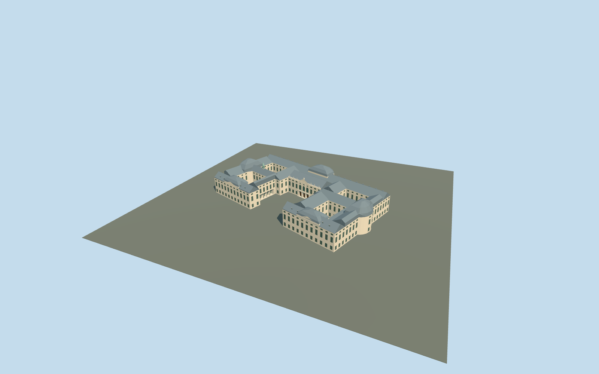

# Würzburg Residence

Würzburg Residence complete connected palace exterior on its actual relation outline: open western Ehrenhof and four fully open mapped inner courtyards; long sandstone garden range with central taller pavilion, steep slate roofs and two curved outer roof masses, western wing-end pediments, repeated three-level glazing/cornices, triple western and garden entrances, physical front columns and recessed side colonnades. Low dormers, balustrades, restrained original abstract roof figures and small verdigris turret carry the photographed identity. Gardens/fountain, separate town buildings and interiors remain outside this building model. No copied sculpture, frescoes, text or interior decoration.

## Evidence and reconstruction

Published dimensions and reconstructed details are separated in spec.json. Primary references:

- [Reference](https://commons.wikimedia.org/wiki/File:Residenz_Würzburg_von_oben.jpg)
- [Reference](https://commons.wikimedia.org/wiki/File:20230105_Würzburg_Residence_01.jpg)
- [Reference](https://www.castleholic.com/2018/01/wurzburger-residenz.html)

Würzburg Residence complete connected palace exterior on its actual relation outline: open western Ehrenhof and four fully open mapped inner courtyards; long sandstone garden range with central taller pavilion, steep slate roofs and two curved outer roof masses, western wing-end pediments, repeated three-level glazing/cornices, triple western and garden entrances, physical front columns and recessed side colonnades. Low dormers, balustrades, restrained original abstract roof figures and small verdigris turret carry the photographed identity. Gardens/fountain, separate town buildings and interiors remain outside this building model. No copied sculpture, frescoes, text or interior decoration.

## Model and axes

10,080 triangles; 27,004 vertices; 6 material groups; 1,096,960 bytes. Native bounds: -80.347, -2.978, -97.693 to 60.687, 31.700, 90.757. Source hash: `sha256:fd9ef9d26ac53bccbd75332cfcf0bd93977989a03854598b0b1fde2050f59fdf`.

{"x":"east","y":"up","z":"south"}

The geographic proposal uses exact-QID OpenStreetMap evidence. Map-derived orientation and estimated architectural details require real-site visual review; preview eligibility is distinct from geographic/fidelity approval. Map attribution: © OpenStreetMap contributors, ODbL-1.0.

## Reproduce

Run `node packages/worldgen/scripts/generate-additional-landmarks.mjs --ids=N0771` (or add `--check`). The generator preserves manually edited masters by checking their baseline hashes. Import through the standard authored-model workflow with optimization disabled; then capture all QA cameras, including shared-surface views.

## Pending work

- Würzburg Residence complete connected palace exterior on its actual relation outline: open western Ehrenhof and four fully open mapped inner courtyards; long sandstone garden range with central taller pavilion, steep slate roofs and two curved outer roof masses, western wing-end pediments, repeated three-level glazing/cornices, triple western and garden entrances, physical front columns and recessed side colonnades. Low dormers, balustrades, restrained original abstract roof figures and small verdigris turret carry the photographed identity. Gardens/fountain, separate town buildings and interiors remain outside this building model. No copied sculpture, frescoes, text or interior decoration.
- Q156316 and named Residenz Würzburg POI identify OpenStreetMap relation7074/native52776558140322. Own this one complete connected parent only; no additional overlapping building records in the standard extract. Its39-vertex outer boundary and four actual court holes supply scale. Origin is the midpoint of western central facade edge32→33. Internal X south/slightly west along the west front; Z west/slightly north into Ehrenhof. Baked native east/up/south axes, heading0. Hole-free ownership/ground partitions retain all four original court grounds, the open forecourt and independent city buildings; no outline is allowed to fill a court.
- Three ordinary front/aerial pictures guide medium-fi exterior. Mapped23m height is an approximate envelope, not surveyed levels. Working lower walls18m with slate hips to24m, curved outer roofs to29m and central garden pavilion walls22m/roof29.5m plus original abstract crown to32m, above+.2m floor. Three-level facade rhythm, roof subdivisions/dormers, colonnade counts, curved roof profiles, ornaments and small turret are approximations. No copied statues, coats of arms, frescoes, inscriptions, furnished rooms or fountain/garden sculpture.
- Qualified approximate native palace exterior fit on original Protomaps20261020/Mapzen201x201/6m ground. Open Ehrenhof provider[0,10] supplies188.94774001662032m datum. Boundary grades-2.798..+.482m; floor+.2m and foundation-2.978m provide supported bases with up to about3m of low-side plinth exposure and modest high-side burial. Four actual court holes and open forecourt retain original terrain; their exact historic paving/levels remain approximate. A closed raised western apron supports four front columns and thresholds; recessed side colonnades retain original adjoining ground. Four hole-free occupied partitions plus apron mask remove only palace contact ground. All independent town buildings, garden approaches, roads and water remain intact. Native views establish approximate contact; flat review planes partly bury grade-specific bases. No bespoke terrain/survey or flattening; exact thresholds and accessibility unverified.

This bundle follows the medium-fi standard. Medium-fi appearance and geographic fit are reviewed separately. Hash-bound visual acceptance is recorded separately after capture inspection.
