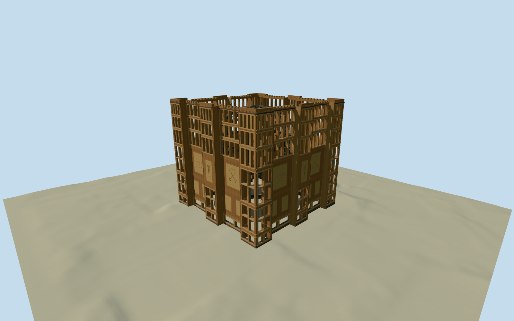

# Jezreel's Tower

The roofless shell of Jezreel’s Tower in 1903, with four brick elevations, open windows and the circular assembly hall’s skeletal steel dome.

Authoring state: **review-in-qa.json**. Current completion evidence is in [qa.json](qa.json) and the [completion ledger](../../../../qualla-structures/batches/qualla-004.PROGRESS.md).

- [Jezreel's Tower](https://qualla.com/jezreel-s-tower/)

The model represents the unfinished tower about August 1903. The exact heights and footprint heading vary among the contemporary accounts and are approximate.

Most floor and steel details are reconstructed at medium distance from the imagery. The modern terrain establishes the location; the old approach, basement depth and surrounding 1903 landscape are estimated.

Build: `node content/worldgen/source/places/u1/u10/jezreel_s_tower/models/generate-jezreel-s-tower.mjs`. Add `--check` to verify exact regeneration. 31080 triangles; 4 materials; no embedded photographs.
