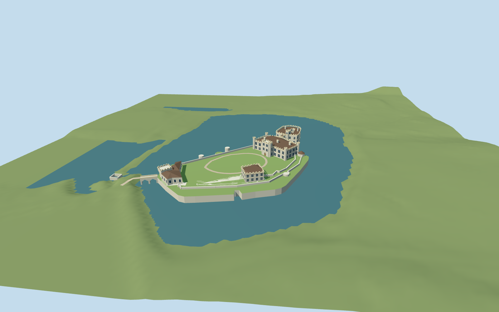

# Leeds Castle

Current two-island Leeds Castle: Tudor-style New Castle/octagonal turrets, D-shaped hollow Gloriette with bell tower, two-storey covered bridge over open pointed arches, Maidens Tower/bath arches, medieval southwest gatehouse, low curtain/island and entrance bridge.

## Evidence and reconstruction

Published dimensions and reconstructed details are separated in spec.json. Primary references:

- [Reference](https://api.openstreetmap.org/api/0.6/map?bbox=0.6267,51.2465,0.6333,51.2510)
- [Reference](https://www.leeds-castle.com/)
- [Reference](https://www.leeds-castle.com/her-castle/history-of-the-castle/)
- [Reference](https://www.leeds-castle.com/news/stonework-restoration-of-leeds-castle/)
- [Reference](https://www.leeds-castle.com/wp-content/uploads/2022/10/Thomas-Alexander-Castle-scaled.jpg)
- [Reference](https://www.leeds-castle.com/wp-content/uploads/2025/07/history-of-castle.jpg)
- [Reference](https://www.leeds-castle.com/wp-content/uploads/2023/07/IMG_5960-scaled.jpg)
- [Reference](https://historicengland.org.uk/listing/the-list/list-entry/1039919)

Five existing shared256-square masonry/raw stone/clay tile/timber/gravel graphs with metric repeats and linear tints. Flat glass/lawn. No embedded/new image, downloaded mesh or copied photo texture.

## Model and axes

11,755 triangles; 35,265 vertices; 7 material groups; 1,414,664 bytes. Native bounds: -127.916, 0.000, -86.626 to 55.786, 22.250, 74.419. Source hash: `sha256:d16b54283a0f86440f462d94a9e9e5c41b4530f2a8f7dab7e021e1bd9878df27`.

{"up":"+Y","longitudinal":"Native +X east,+Z south; original NE/SW authoring-axis rotation is baked into vertices, runtime heading0.","origin":"Original horizontal exact-QID anchor. Local Y0=56.28m ODN LiDAR flat lake surface; reconstructed6m bailey above moat; signed East/South native axes and runtime heading0."}

Native +X East,+Z South and heading0 retain attributed castle relation6941053, component footprints, island and approach. Absolute base56.28m ODN uses the public Environment Agency DTM flat lake surface; current uniform bailey62.28m sits near the mapped path median62.245m. Floor, arch sections and current water level remain declared reconstruction. Host water/terrain must match ODN; no tidal sea-level assumption.

## Reproduce

Run `node packages/worldgen/scripts/generate-signature-towers.mjs --ids=leeds_castle` (or add `--check`). The generator preserves manually edited masters by checking their baseline hashes. Import through the standard authored-model workflow with optimization disabled; then capture all QA cameras, including shared-surface views.

## Pending work

- Current medium-fi exterior uses attributed current map traces, Historic England architectural descriptions and operator photos. Numeric roof/window/turret sections and arch dimensions remain photographic reconstruction; no surveyed architectural heights.
- Public2022 composite DTM supplies flat lake56.28m ODN and mapped bailey path61.562–62.762m, median62.245m. Uniform62.28m castle floor is reconstructed. DTM building removal makes the Gloriette court too low; it is not used as a measured floor.
- Original4.4m rise master is preserved. The current6m floor derivative stretches subfloor masonry and arches and raises upper architecture1.6m without changing horizontal footprints. Convex ground cutout prevents host terrain poking through the island/castle; matched ODN water and terrain are required.
- Source4m review grid samples the public1m DTM using a2m nominal-accuracy horizontal transform. Terrain under the convex architectural/island envelope is sunk below water with6m grid padding, water cells lowered0.35m and an opaque flat review lake inserted. Raw heights remain in terrain-grid.json. Fixture is not current water survey, bathymetry or host-terrain certification.
- Gloriette courtyard, covered-bridge/bath water arches and mapped gate route are open geometry. Window panes are stylized opaque blue-grey. Convex collision is not a walkthrough navigation mesh.
- Fairfax Courtyard, detached service buildings, parkland, trees, fine tracery/heraldry/interiors, temporary2023scaffolding and full outer barbican archaeology are excluded. The model includes only the nearby mapped fragment.
- Five existing shared256-square sandstone, raw limestone, flat clay tile, wood and gravel graphs; flat opaque glass/lawn, metric UVs and linear tints. No embedded/new photo texture or downloaded building mesh. Operator photographs remain private research.
- Physical phone/laptop timing, downtown memory and seasonal water-level fluctuations remain unmeasured.
- Mapped connecting footpath94361177 joins the entrance bridge to the outer approach. Width3m and final two level controls are reconstructed; first two heights sample the public DTM. Full barbican archaeology remains excluded.

This bundle follows the medium-fi standard. Medium-fi appearance and geographic fit are reviewed separately. Hash-bound visual acceptance is recorded separately after capture inspection.

## Additional geographic data

© OpenStreetMap contributors; Historic England; Leeds Castle Foundation/Thomas Alexander.
