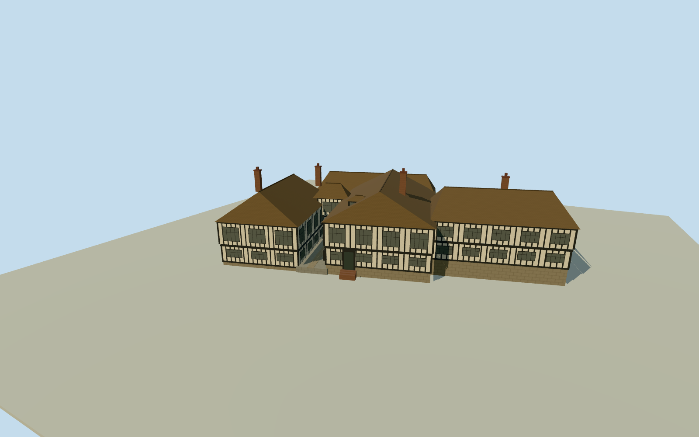

# The Mermaid Inn

The Mermaid Inn’s black and white timber wings, clay-tile roofs, brick chimneys and cobbled courtyard on Mermaid Street.

Authoring state: **review-in-qa.json**. Current completion evidence is in [qa.json](qa.json) and the [completion ledger](../../../../qualla-structures/batches/qualla-003.PROGRESS.md).

- [The Mermaid Inn, Rye](https://qualla.com/the-mermaid-inn-rye/)

The model represents the principal Mermaid Inn street wings and their inner courtyard in 2019. The shared building row continues into adjoining properties.

The street photographs determine the half-timbering, roof and chimney character. Exact property divisions at the rear, court and steps are approximate.

Build: `node content/worldgen/source/places/u1/u10/mermaid_inn_rye/models/generate-mermaid-inn-rye.mjs`. Add `--check` to verify exact regeneration. 3576 triangles; 6 materials; no embedded photographs.
