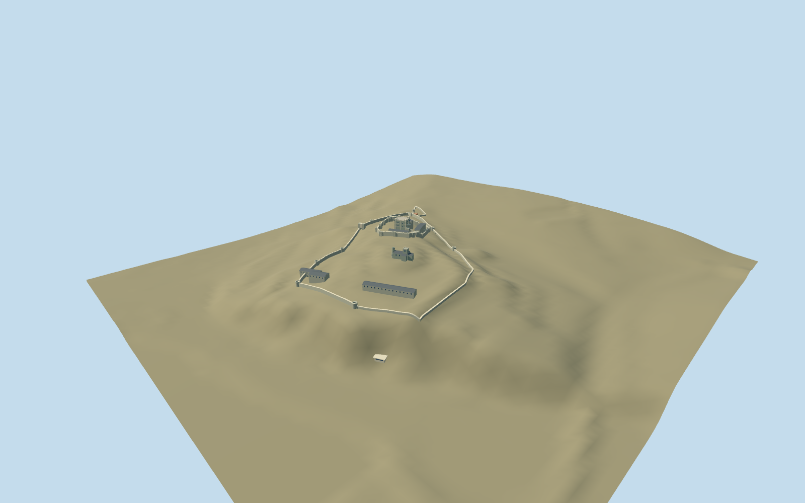

# Dover Castle

Current multi-period hilltop fortress:square flint-and-pale-stone Great Tower with east forebuilding,14inner mural towers,lowered outer defenses,northern spur,Constable gate,church/octagonal Roman pharos and selected later barracks.

## Evidence and reconstruction

Published dimensions and reconstructed details are separated in spec.json. Primary references:

- [Reference](https://www.english-heritage.org.uk/visit/places/dover-castle/history-and-stories/history-dover/)
- [Reference](https://www.english-heritage.org.uk/siteassets/home/visit/places-to-visit/dover-castle/schools/ocr-gcse_history-around-us_dover-castle_final_updated.pdf)
- [Reference](https://historicengland.org.uk/listing/the-list/list-entry/1019075)
- [Reference](https://www.english-heritage.org.uk/siteassets/home/visit/places-to-visit/dover-castle/history-and-stories/history/dover-castle-phased-plan.pdf)
- [Reference](https://www.openstreetmap.org/way/26658038)
- [Reference](https://github.com/tilezen/joerd/blob/master/docs/data-sources.md)

No third-party geometry, photograph or bitmap texture is embedded. Shared surface graphs come from the central library; vertex tints carry model colors. Glazing uses PBR materials; transparent surfaces are declared per model.

## Model and axes

4,732 triangles; 14,196 vertices; 6 material groups; 571,596 bytes. Native bounds: -223.209, -80.966, -231.396 to 229.387, 30.545, 292.830. Source hash: `sha256:828ca564441df5aaf6c59fd6d7ac3e811a648881de370a243a8e505745b7b49b`.

{"up":"+Y","lateral":"+X east","longitudinal":"+Z south","origin":"Site anchor; Y0 standard PMTiles working datum."}

Inspected aerial picture confirms the square Great Tower, concentric mural towers, gatehouses, church/pharos group and later barracks. The retained east/south site frame and standard viewer PMTiles set approximate location, scale and orientation. The derivative omits the embedded hill, uses host PMTiles terrain, reconstructs level keep/church floors above coarse sampled ground and extends their bounded wall bottoms beneath it. Anchor 1.322679734,51.129258466; heading 0; standard PMTiles datum 110.20328505915221m. Floors are reconstructed and foundations extend below the coarse sampled ground.

## Reproduce

Run `node packages/worldgen/scripts/generate-signature-towers.mjs --ids=N0284` (or add `--check`). The generator preserves manually edited masters by checking their baseline hashes. Import through the standard authored-model workflow with optimization disabled; then capture all QA cameras, including shared-surface views.

## Pending work

- Approximate current exterior from one inspected picture and standard viewer PMTiles; no bespoke survey or exact door/threshold review.
- Original master recipe, relative terrain and hash preserved. Runtime derivative contains architecture without a duplicate mountain.
- Keep/church working floor levels are reconstructed; outer walls follow coarse terrain. Internal site plan is approximate; no tunnels, interior, terrain cutouts or lost structures.
- Five shared material graphs plus a local dark recess slot; zero embedded images. Site footprint replacement stays off; physical-device timing remains unmeasured.

This bundle follows the medium-fi standard. Medium-fi appearance and geographic fit are reviewed separately. Hash-bound visual acceptance is recorded separately after capture inspection.

## Additional geographic data

© OpenStreetMap contributors;Mapzen Terrain Tiles/contributing agencies;English Heritage and Historic England factual architectural references.
