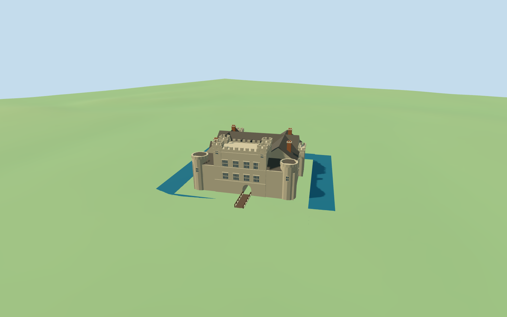

# Hever Castle

Moated Hever Castle: crenellated gatehouse with four square angle turrets, lower rounded front towers, roofed courtyard ranges, cream/dark Tudor inner façades with three gables, selected chimney stacks and the mapped south entrance bridge.

## Evidence and reconstruction

Published dimensions and reconstructed details are separated in spec.json. Primary references:

- [Reference](https://www.hevercastle.co.uk/wp-content/uploads/2024/10/DJI_0240-HDR-_1_Autumn_Hever_Castle-1020x679.jpg)
- [Reference](https://commons.wikimedia.org/wiki/File:Hever_Castle_4_(2021).jpg)
- [Reference](https://henryviiihouses.byu.edu/files/2019/01/Hever-inner-courtyard-1024x768.jpg)

Five canonical shared graphs provide stone, slate, brick, wood and lime plaster. Glazing uses a tinted untextured PBR slot. No unique bitmap or embedded photograph.

## Model and axes

8,898 triangles; 26,694 vertices; 6 material groups; 1,071,452 bytes. Native bounds: -20.025, -0.521, -19.852 to 20.025, 15.700, 21.036. Source hash: `sha256:72eff21ebcd024cd9ad1539b51c2ed64ff0e7aa39733f25652b51b4d402d33a9`.

{"x":"+X east","y":"+Y up","z":"+Z south"}

The named Hever Castle PMTiles point and same-ID building polygon control the envelope and open courtyard. Native east/south axes already contain the mapped facade rotation; placement heading 0 avoids a second rotation. The separate northwest hotel stays procedural. Heights, window rhythm, exact banks and moat water remain approximate.

## Reproduce

Run `node packages/worldgen/scripts/generate-additional-landmarks.mjs --ids=N0312` (or add `--check`). The generator preserves manually edited masters by checking their baseline hashes. Import through the standard authored-model workflow with optimization disabled; then capture all QA cameras, including shared-surface views.

## Pending work

- Roof, turret, chimney and window heights and cadence are picture-led approximations against the retained standard viewer footprint; not surveyed architecture.
- Terrain and moat banks are coarse. Blue preview moat bands are approximate context only; the asset relies on host mapped water. Exact bank/deck joins and underwater footings remain approximate.
- The separate northwest hotel/Tudor village, gardens, seasonal ivy, interior furnishings and certified walkable collision are excluded.
- Physical laptop and phone frame-rate measurements remain pending.

This bundle follows the medium-fi standard. Medium-fi appearance and geographic fit are reviewed separately. Hash-bound visual acceptance is recorded separately after capture inspection.

## Additional geographic data

© OpenStreetMap contributors; Protomaps; Mapzen/USGS terrain tiles.
