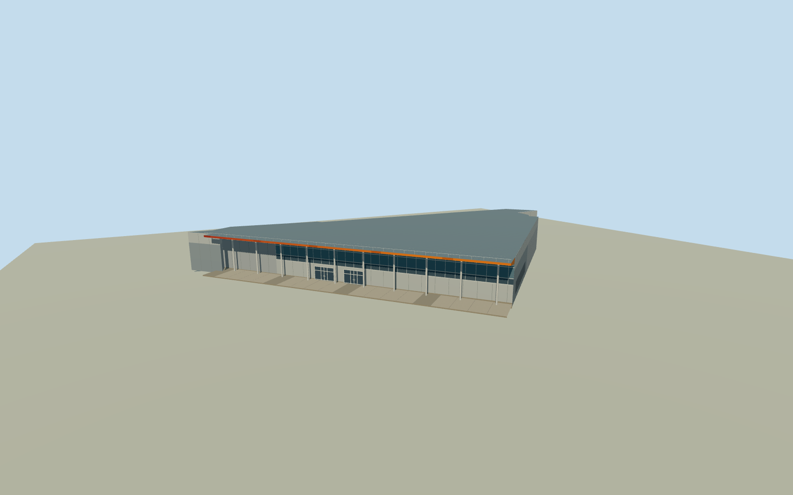

# Eurotunnel Calais Terminal

The Eurotunnel passenger terminal at Coquelles, with its triangular plan, silver-panel walls, banded glazing, white columns and projecting red-orange roof canopy.

Authoring state: **review-in-qa.json**. Current completion evidence is in [qa.json](qa.json) and the [completion ledger](../../../../qualla-structures/batches/qualla-003.PROGRESS.md).

- [Eurotunnel Calais Terminal](https://qualla.com/eurotunnel-calais-terminal/)

The model covers the Charles Dickens passenger building photographed in July 2024. Adjacent Cité Europe, artwork, advertising and the shuttle tracks are outside its scope.

The mapped frontage line controls the long orange-red canopy. Setback, height, vestibule stations, and the elevations outside the published photograph are visual estimates.

The original terrain is retained. The paved passenger approach, facade floor and individual column contacts have approximate elevations.

Build: `node content/worldgen/source/places/u1/u11/eurotunnel_calais_terminal/models/generate-eurotunnel-calais-terminal.mjs`. Add `--check` to verify exact regeneration. 2146 triangles; 6 materials; no embedded photographs.
