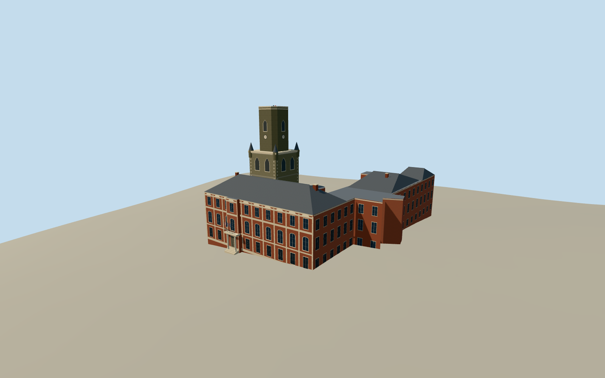

# Hotel de Ville, Boulogne-sur-Mer

A ten-bay red-brick civic hall with limestone bays and balcony under dark slate, joined to the medieval square belfry and its clock and octagonal upper stage.

Authoring state: **review-in-qa.json**. Current completion evidence is in [qa.json](qa.json) and the [completion ledger](../../../../qualla-structures/batches/qualla-003.PROGRESS.md).

- [Hotel de Ville, Boulogne-sur-Mer](https://qualla.com/hotel-de-ville-boulogne-sur-mer/)

The principal mapped city hall outline and belfry heritage location guide the model. The square belfry base and exact roof intersections are reconstructed from the archive view and architectural records.

Secondary façade bays and roof volumes are estimates. The historical museum photo informs retained belfry fabric and proportions. The municipal street front uses the 2004 public-domain exterior.

The original street terrain is preserved. Finished threshold and attached surfaces are approximate at terrain resolution.

Build: `node content/worldgen/source/places/u1/u11/hotel_de_ville_boulogne_sur_mer/models/generate-hotel-de-ville-boulogne-sur-mer.mjs`. Add `--check` to verify exact regeneration. 5554 triangles; 6 materials; no embedded photographs.
