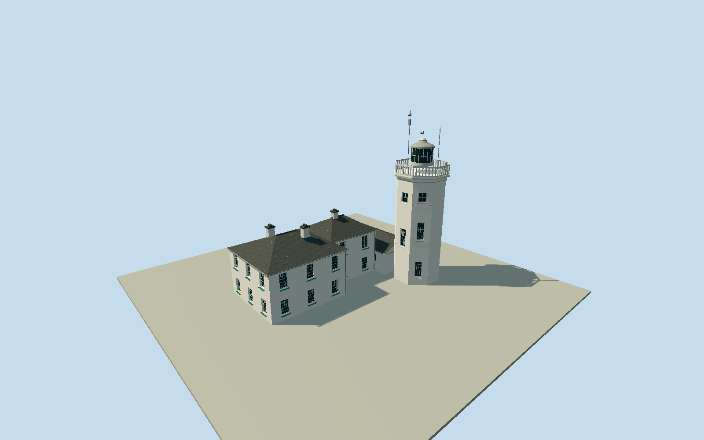

# Cromer Lighthouse

Whole connected surviving Cromer Lighthouse building: white1833octagonaltower, steppedgallerycornices andopenbalustrade, modernsmallglazedlantern/roundedcap/finial/weather vane andbounded2007radiomastdetails; all attachedL-shapedkeeperaccommodation, represented bylowgable-rooflink andtwo two-storeyhippedcottagewings/whitewalls/paintedsashes/greenfittings/chimneys. Completeoriginalnine-pointconnectedbuildingenvelope, notjustthetower oronecottage. Exclude detachedgarage/golfclub/chaletpark, widerpropertyboundary/gardenwalls withouta verifiedwholetrace, pavedyard/grass/slopingnaturalcliff/sea/trees andinteriors. Original9pointcoarsewholeLplan boundsallattachedaccommodation; interpret3roofvolumesfromsourcephoto/operatorthreecottages. NEoctagontower5moffsetfromgeneralPOI derivedbeforeterrain, notmisclaimedasmeasured. 18mstructuraltower plusseparatesmallfinial/weatherhardware/radiomast. Preserveeightflatwhitefaces/steppedcornices/fullyopenoctagonalbalustrade/roundglazedlanternandmetalcap, source-visibletwooffsetwindowstacks/recessedwhiteframes, twohippedwhitecottagewings/slatetiles/chimneys/greentrim andlowgablelink. Hiddenrearwindows/finecurrentequipment estimated; no opaquegalleryrailslab, genericcylinder/wholeflatLblock/84mtower, noyard/cliff/grass/sea mesh. Freezeindependent256m129²fieldatfixedNEapproachbeforegeometry; retainall16641samples/PNG/rawtiles.

Authoring state: **review-in-qa.json**. Current completion evidence is in [qa.json](qa.json) and the [completion ledger](../../../../qualla-structures/batches/qualla-002.PROGRESS.md).

- [Cromer Lighthouse](https://qualla.com/cromer-lighthouse/)

NativeconnectedL-buildingway345723769 hasoriginal9perimeterpoints, distinctfromnearbydetachedgarage680776047/chalet/golfclub. Native855264061/Q2752583 isgeneral lighthousePOI, notmeasuredtowercentre. Beforegeometry/ground, align+Xalongoriginalupperarmfirstedge/+Zsouthwestalongcottages. Toweroctagon interpretedatNEendofnativeupperarm: centre[5,-.86],circumradius3.1m fitsits5.67macrossarm/NEend andclearsourcephoto. Thisisapproximately5mfromgeneralPOI andisexplicitlyphoto/outline-derived,notsurveyed. Nativepolygonisonecoarsewholebuildingenvelope, notseparateroom/wall/eaves survey; subdividedtwo2-storeyhippedwings pluslowgablelinkinsideexistingL, no inventedextraoutlyingcottages. Exposedoctagonprojectsmodestlybeyondcoarserectangularaggregatecorner, finefootprintoffsets/verticals/hiddenrearopenings approximate. Link east-end extends0.1m beyond initial2.1m subdivision estimate to2.2m, ensuring actual attachment to octagon western flats; whole native9pointaggregate and independentfield unchanged. Internal roofpartcorners remain photo-bounded, not measured.

Whole1833octagonaltower and allconnectedkeeperaccommodation retained as two two-storeyhippedwings andlowgabledlink. Original9pointnativeaggregateoutline preserved incontrols; finepartsubdivision/towercentre[5,-.86]/3.1mradius/eaves5.8m/ridges7.65–7.8m/link3–4.6m estimatedfromsingleclearwholephoto. Official18mstructuraltower separatefrom84mMHWlight elevation; mainshaft13.25m/gallery13.95m/lantern17m/roof18m/finial18.8m/mast21.1m are photo-boundedintermediates andhardware, notsurveyedlevels.

Qualla-first30families/0reservedconflicts;publishedmodernexteriors attribution-requiring andunused. OneStavros1own2007original:explicitnativePD-user-en grant boundtoexactsame-name/date/size/original-uploaddescription andnativeSHA1/originalpixels. NativePermissionabsent, acceptedonlybystrictsamelineoriginalphotographer-uploadproof; no source metadata/category/articlebody edits. Allarchitecturalreferencepixelsinspected; operator2025textconfirmssurvivingoctagonaltower/20thcenturylantern/threecottages. No restrictedphotos,photo-textures/generatedbitmap/downloadedmesh.

Whiteeightflatshaftfaces/steppedcornices/physicallyopenwhiteoctagonalbalustrade/rounddarkglazedlantern/slimframes/grayroundedcap/weatherhardware. Twoobservedoffsetwindowstacks physicallyrecessedatdetailedLODs; whitecottagepaintedsashes/greensills/grayhippedslateroofs/chimneys/lowblankgablelink. Hiddenrearwindowcensus/roofvalleys/cottagepartitions/currentradiomastdetails,2007greenpaint/trimandpatina approximate. Skylinewindowdepth/slatecourses/finesashbarsandbalusters simplify; entireconnectedbody/crown preserved.

Detachedgarage/chaletpark/golfclub/widerboundarywalls withoutwholetrace/yardpaving/grass/cliff/sea/trees/interiors excluded. No hugepropertyslab or inventedvisiblefoundation. Standaloneportable/shared/contextflatfixtures separatefrom truegeographicgrade; ordinarypreview/replaceFootprint=false.

Independent256m129x129field/all16641values/twooriginalrawtiles/PNG frozenbeforegeometry unchanged; providerNEapproachdatum74.8043m,absolute47.3–75.4315m,relative-27.5043–.6272m. Terrainfieldisnotfinefoundation/cliffthreshold survey; actualhostcontactunverified. No terrainfit/flatten/reacquisition.

Build: `node packages/worldgen/scripts/generate-authored-places.mjs --ids=cromer_lighthouse`. Add `--check` to verify exact regeneration. 9900 triangles; 5 materials; no embedded photographs.
