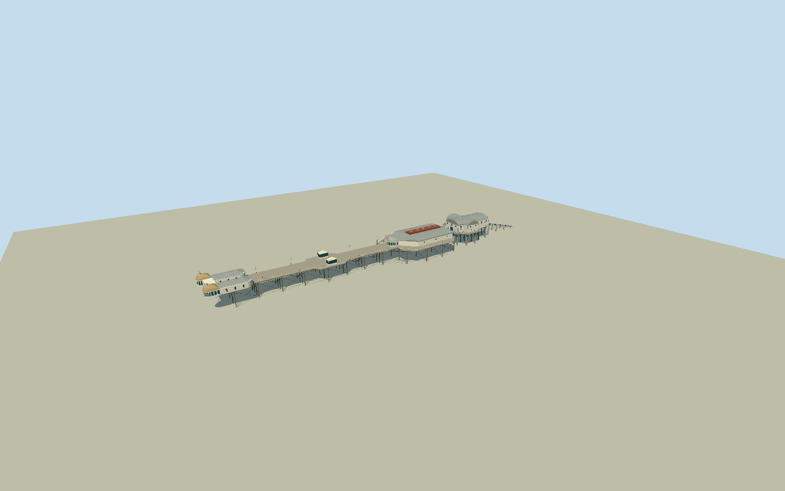

# Cromer Pier

Whole Cromer Pier including full55point deck,54point entrance complex with twin domed windowed kiosks/open portico/hip-roof shop wings,2mapped middle shelters,16point shaped-roof Pavilion Theatre,13point contemporary RNLI boathouse and complete seaward launch slipway. Steel pile bents/Xbracing/underdeck girders, concrete RNLI piles, timber deck and open railings/lamps integral. Nominal151m mainpier plus RNLIextension/ramp gives~232m whole envelope. Exclude town/promenade/cliff/beach/sea/groynes, temporarybunting/scaffold/adverts/vehicles/people/interiors/lifeboats. Gray-brown timberdeck/creamwhitewalls/whiteyellowrails/weatheredgoldentrydomes/grayshapedmetalroofs/redTheatreventcrown/blueRNLIframes/brownblacksteelXbracing. Realopenunderstructure/entryportico, distincttwinsmallroundfrontbooths andhippedlongshopwings, twohippedmiddleviewingshelters, curvedTheatreroofandfrontrotunda, crossbarrelRNLIboathouse andsteepfullramp. Nativeentryconcavity/shoreportal notfilled; no broadsolidpierfoundation.

Authoring state: **review-in-qa.json**. Current completion evidence is in [qa.json](qa.json) and the [completion ledger](../../../../qualla-structures/batches/qualla-002.PROGRESS.md).

- [Cromer Pier](https://qualla.com/cromer-pier/)

Nativewholedeckway29146061/all55points, entrance1105720160/all54, theatre345723596/all16, RNLI345720938/Q5187605/all13, shelters1105721359/360/all4each and launchline894953503/bothends;148controlpositions. Fixedwhole-envelope midpointanchor[1.301362373987987,52.933753233574976],heading1.271094611728041 from nativeentrance-to-RNLIaxis beforeterrain/geometry; +XseawardNNE/+ZapproximatelyESE. Complete232mby35m envelopefits256mfield, unlike originalstorycoordinate atRNLIhead. Coarsemapplan isnot roof/pile survey. Operator151m appliesmainhistoricpier, notfullRNLIramp envelope. Deck/roof/pile/ramp levels/bent census/roofsplit estimated independently ofterrain; nativeele10 andtheatreheight5 arecoarsehints only.

Complete55pointdeck/54pointentry/16pointtheatre/13pointRNLI/2shelters4pointseach/launchline2endpoints retained. Entryroofsubdivision/domedboothshapes/hipwings/openportico/theatreshapedroof/RNLIcrossbarrel/pilecensus/railspacing/launchgrade and hiddenminordetail estimated from4clearphotos/nativeplan. No town/promenade/coastbeach/sea/groynes/temporarybunting/scaffold/adverts/people/vehicles/boats/interiors.

OneexactpublishedNorthmetpitPD2008RNLIfront andthree supplementalnativeownPD/CC0originals individuallyinspected/nativeSHA1bound. Mainnativecategory284files/no continuation; existingnativehelperpassedall3. PublishedStavros2007metadata-disagreement image notused, no source-record/category/policychanges. Primaryoperator/heritage/RNLItextonly, protectedofficialplans/photos notused; no phototexture/generatedbitmap/downloadedmesh.

ArchitecturalY0piletoe/deck9.5m/entryeave12.65m/domerise2.6m/theatreeave12.7m/roof+2m/raisedcrown15.55m/RNLIeave14.7m/curvedroof+2.8m/slipwayfoot.3m independentlyestimated beforeterrain. Coarse nativeele10/theatreheight5 are notsurveycontrol. Actualpileembedment/submergedtoe/tide/thresholdregistration unverified.

Independent256m129square2m all16641values/PNG/oneTerrariumtile frozenbeforegeometryunchanged. Providerdatum-1.6723m/sourcepixel2.879468954051165m/absolute-1.7182..7.6034m notsurveyaccuracy. No terrainfitting/flattening/reacquisition, ordinarygeographicpreview/replacementdisabled; flatreviewfixturesseparateactualcoastalground.

Nominalmainpier151m fromoperator reachesTheatrehead; physicallyintrinsicRNLIboathouse/fullseawardramp extend wholeenvelope to~232m. Whole-geometrymodelthereforedoesnottruncateat151m. Current2026permanentpaint/conditionnotcertified; selected2019weatheredgoldentrydomes andgraymetalroof palette.

Build: `node packages/worldgen/scripts/generate-authored-places.mjs --ids=cromer_pier`. Add `--check` to verify exact regeneration. 12171 triangles; 6 materials; no embedded photographs.
