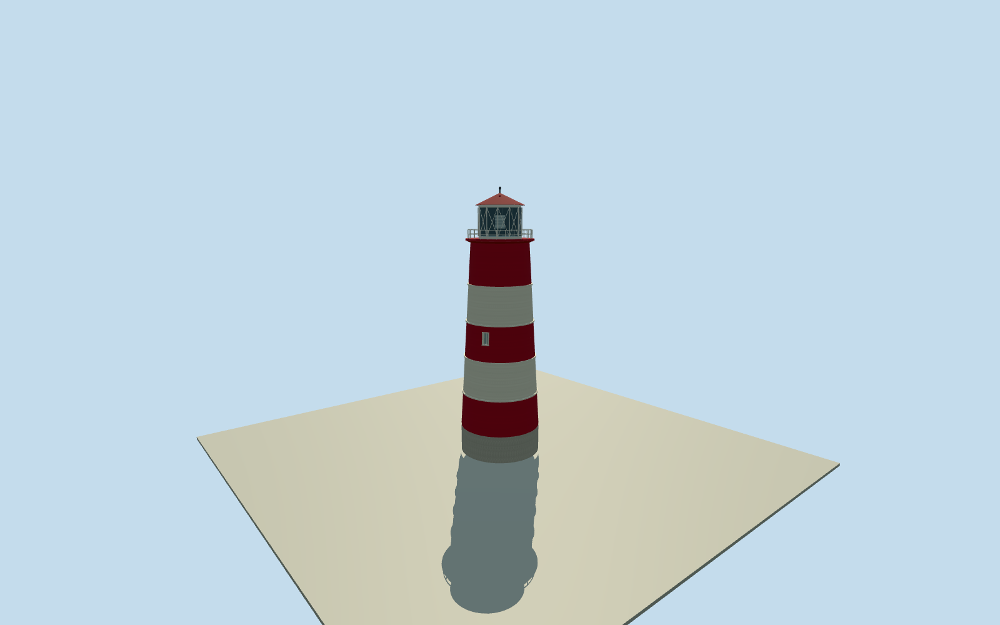

# Happisburgh Lighthouse (2007)

Whole surviving Happisburgh Lighthouse as published in the original2007 photograph: complete tapering circular masonry tower with all three red bands, white belts, base/entry, real exterior window recesses, full projecting gallery/cornice/railing, lantern drum and glazed light-facing panels/diagonal braces, closed red conical roof and finial. Primary tower26m, actual native18-control building/Q5652375. Separate adjacent keeper cottages/trees/field/park/pillbox are outside the tower building scope. Hidden entry/window registration/backlantern/sections/radii/grade are bounded estimates, no exact survey claim. Do not substitute a painted cylinder without lantern/gallery/roof/openings.

Authoring state: **review-in-qa.json**. Current completion evidence is in [qa.json](qa.json) and the [completion ledger](../../../../qualla-structures/batches/qualla-002.PROGRESS.md).

- [Happisburgh Lighthouse](https://qualla.com/happisburgh-lighthouse/)

Actual18-control named Happisburgh High Lighthouse way212790843/Q5652375, ordinary u1/u13 source. Actual ring center corrects distant storycoordinate context, not moved to storypoint. Nativeheight45 is not physical towerheight; localprimarytechnicalpage says26m versuslight41mabove tide. Separate cottages are not tower footprint. Hidden registered door/window/bearing/sections/radii/grade estimated; all1077reservationsclear.

Whole surviving Happisburgh Lighthouse as published in the original2007 photograph: complete tapering circular masonry tower with all three red bands, white belts, base/entry, real exterior window recesses, full projecting gallery/cornice/railing, lantern drum and glazed light-facing panels/diagonal braces, closed red conical roof and finial. Primary tower26m, actual native18-control building/Q5652375. Separate adjacent keeper cottages/trees/field/park/pillbox are outside the tower building scope. Hidden entry/window registration/backlantern/sections/radii/grade are bounded estimates, no exact survey claim. Do not substitute a painted cylinder without lantern/gallery/roof/openings.

Independentoriginalfield/frame beforeallfloors/mainsections/geometry. Neverflatten/reacquire/reframe/refitmainparameters afterrender.

Wholelighthouseheight26m fromprimarylocaltechnicalpage; radii/taper/heightpartition/geometricbraces/hiddenentry/windowbearings/sections/grade boundedestimates. No precisehistoricgroundsurvey or protectedphotos adopted.

Complete lighthouse itself: full tapered masonry, all bands, real recessed door/window holes, gallery/cornice/rail, full lantern with glazed sea-facing half and opaque black interior back, structural diagonals/optic/closedconicalroof/finial/entry steps. Neighbor cottages independent/outside tower scope. No surroundingfield/trees/fences/pillbox copied.

Primary localtechnicalheight26m isphysicaltower; light41m above meanhighwater, native45m wrongfortower. Verticalpartition/radii/taper/smallbelts/windowandentrybearings/hiddenrear/grade areboundedphotographicestimates. Originalphoto2007upload, notexactcaptureday.

Sourcefieldaroundtowerapproach near−.3..+.4m, farther coast drops within256m; rawground maypartiallyconcealfoundation orentry treads. Originalfield/frame/mainsectionsretained. No cutout/mask/flattening/sitepad.

Build: `node content/worldgen/source/places/u1/u13/happisburgh_lighthouse/models/generate-house.mjs`. Add `--check` to verify exact regeneration. 15694 triangles; 5 materials; no embedded photographs.
