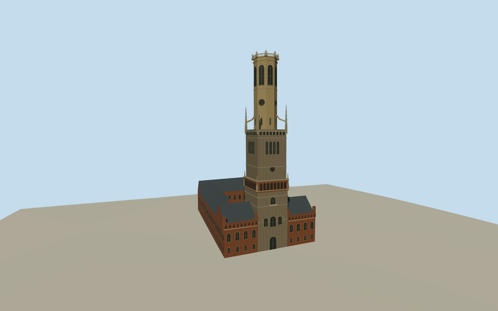

# Belfry of Bruges

The Belfry of Bruges and its market halls in 2005, with a corbelled brick gallery, paired Gothic openings, an octagonal sandstone lantern and openwork crown.

Authoring state: **review-in-qa.json**. Current completion evidence is in [qa.json](qa.json) and the [completion ledger](../../../../qualla-structures/batches/qualla-003.PROGRESS.md).

- [Belfry of Bruges](https://qualla.com/belfry-of-bruges/)

The model covers the 2005 belfry and market hall exterior around the courtyard. The 83 m height, one-meter southeast lean and mapped outlines set the principal controls.

Stage heights, the courtyard galleries, rear fenestration, roof details and Gothic ornament are estimated or simplified.

Build: `node content/worldgen/source/places/u1/u14/belfry_of_bruges/models/generate-belfry-of-bruges.mjs`. Add `--check` to verify exact regeneration. 18348 triangles; 5 materials; no embedded photographs.
