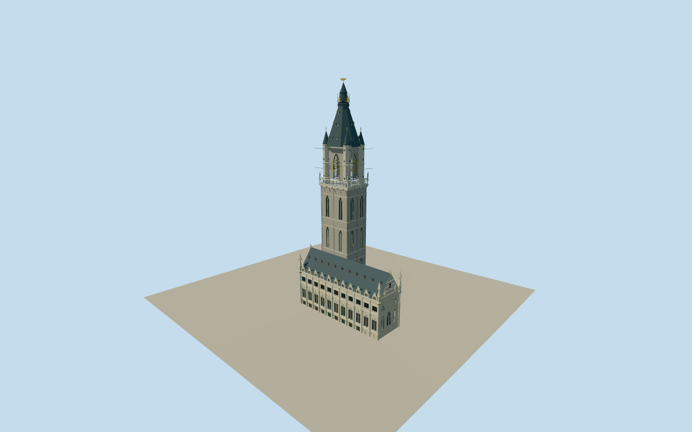

# Belfry of Ghent

Native Gothic civic tower with three paired lancet stages/stringcourses, actual pointed clock-arch openings and skeletal gold Roman clock rings/hands, pierced gallery tracery, four polygonal corner turrets/hourglass shutters/slate spires, thin weather poles/watchmen/gargoyles, central dormered slate spire/open gilded crown and original copper-dragon silhouette. Attached eleven-bay Cloth Hall with stepped buttresses/Gothic cross windows/blind tracery/stepped and timber dormers, corner pinnacles and south stair/gable. Small attached Mammelokker entrance with curved gable/oculus/abstract paired-figure relief. No neighboring churches/market pavilion/square/interior.

Authoring state: **review-in-qa.json**. Current completion evidence is in [qa.json](qa.json) and the [local 100 ledger](../../../../qualla-structures/batches/PROGRESS.md).

- [Belfry of Ghent](https://qualla.com/belfry-of-ghent/)

Exterior based on2004–2018full tower/hall originals with2025spire detail, not a claim of surveyed2026condition.

Native tower15.6×12.1m/hall42.5×12.7m footprints and95/52/67/74/25/16m map heights are nominal controls; component heights/window sizes/ornament/stair engineering proportional estimates. Published heights91,95,101–103m disagree;95moperator/native nominal retained.

Attached Cloth Hall and small Mammelokker entrance included as tower context; no interiors, neighboring churches/market pavilion, square paving/stalls, fine sculptural anatomy, heraldry/inscriptions or photographic textures.

Original simplified Gothic tracery/crockets/watchmen/dragon and annex relief; four LODs must retain open clock rings and balcony counters where budget permits.

Independent terrain acquired before geometry without model fitting or flattening.

Build: `node packages/worldgen/scripts/generate-authored-places.mjs --ids=belfry_of_ghent`. Add `--check` to verify exact regeneration. 51950 triangles; 6 materials; no embedded photographs.
