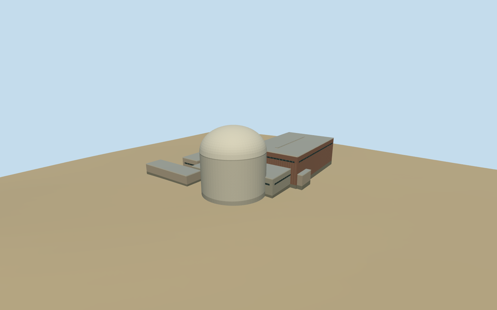

# Borssele Nuclear Power Station

Borssele’s pale concrete dome with low utility ranges and a rust-brown industrial hall in Zeeland.

Authoring state: **review-in-qa.json**. Current completion evidence is in [qa.json](qa.json) and the [completion ledger](../../../../qualla-structures/batches/qualla-003.PROGRESS.md).

- [Borssele Nuclear Power Station](https://qualla.com/borssele-nuclear-power-station/)

Approximate silhouette, divided roof forms and cladding, based on the mapped outer perimeter and public written descriptions.

The model covers the visible dome and connected major masses, with simplified window bands and a graded foundation.

Photographs, other premises and detailed site features were excluded.

Build: `node content/worldgen/source/places/u1/u14/borssele_nuclear_power_station/models/generate-borssele-nuclear-power-station.mjs`. Add `--check` to verify exact regeneration. 3812 triangles; 7 materials; no embedded photographs.
