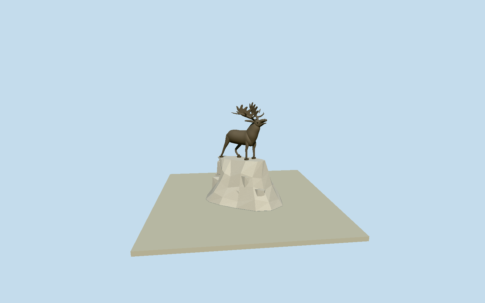

# Courtrai Newfoundland Memorial

Whole specific Courtrai/Kortrijk Newfoundland Memorial: original continuous bronze caribou with raised head/tapered muzzle/open mouth/eyes/brows/pointed ears/dewlap/shaggy chest, full torso/haunches/four distinct straight or bent legs/cloven hooves/short tail, two branching palmate antlers with open forks/airspace, and complete irregular artificial pale laid-rock pedestal/plain plaque carrier within native19control memorial envelope. Seven exact published2017Karmakolleown/selfCC0 originals; no source pixels/inscriptions/park/planting/paths/trees/neighbors copied. Fine anatomy/fur/antler/rock census/hidden profiles and exact bearing bounded original estimates.

Authoring state: **review-in-qa.json**. Current completion evidence is in [qa.json](qa.json) and the [completion ledger](../../../../qualla-structures/batches/qualla-002.PROGRESS.md).

- [Courtrai Newfoundland Memorial](https://qualla.com/courtrai-newfoundland-memorial/)

Native namedmemorial way799193269/Q5178692/area statue stone+bronze establishes actual physical monument location and conservative closed20point extent(19uniquecontrols), not separate ParksCanada park117865413/property area. All19original extent controls retained in map-frame; artificial rock contours/sculptural plans are photographic estimates, not surveyed fine geometry. Exact common bbox anchor/+Xeast/+Zsouth/heading0; source floors/sections/dimensions/figure orientation await independent field freeze and source-based authoring.

All floors/sections/sculptural orientation and geometry follow original200m129x12916641sample independent source field/two rawtile freeze. FixedSW[-12,12]14.3392m provider-relative floor0, not surveyed foundations. Native19control namedmemorial envelope conservatively bounds the artificial rock pedestal, separate park never extruded. Original photographic section estimates: pale rock ridge3.04m with .08m/m front rise; bronze hoof/legs tied to intrinsic stone top before sourcefield render, torso4.62m/raised nose5.98m/antler tips7.23m total. Native-plan longaxis/entry-side photograph inference places raised head NW; exact figure bearing and fine sections are approximate geographic preview, not surveyed sculpture pose. Whole torso/neck/chest/dewlap/muzzle/mouth/eyes/ears/palmate antlers/four hooved legs/bent and extended rear leg/short tail and complete irregular artificial laid-rock pedestal retained. Surface/fur/antler tine/stone census and hidden contours/currentfinish are original bounded estimates. No terrain fit/flatten/reacquisition or later model raising; preview/replacementfalse/sourcegrade unresolved.

Seven exact cleared published2017Karmakolleown/selfCC0 originals individually inspected/nativeSHA1 matched; no supplemental imagery, copied pixels/photo textures/source metadata repair/reclassification. Sculptural anatomy/antlers/fur/stone census/hidden rear/currentfinish and exact figure bearing are original medium-fi approximations, not photogrammetry. Whole native19control memorial extent is conservative physical scope, not individual rock survey; separate park/planting/paths/trees/neighbors excluded. Plain plaque carrier omits inscription/text.

Independent200m129x12916641sample originalfield/two rawtiles/fixedSW14.3392m provider-relative datum frozen before all floors/sections/figureorientation/geometry. No fitting/flattening/reacquisition or later modelraising. Intrinsic hoof-to-artificial-pedestal contacts set during original geometry authoring; external sourcegrade unresolved/preview/replaceFootprint=false. Flat isolated ground/synthetic neighbors are review fixtures.

Build: `node content/worldgen/source/places/u1/u14/courtrai_newfoundland_memorial/models/generate-courtrai-newfoundland-memorial.mjs`. Add `--check` to verify exact regeneration. 22840 triangles; 3 materials; no embedded photographs.
