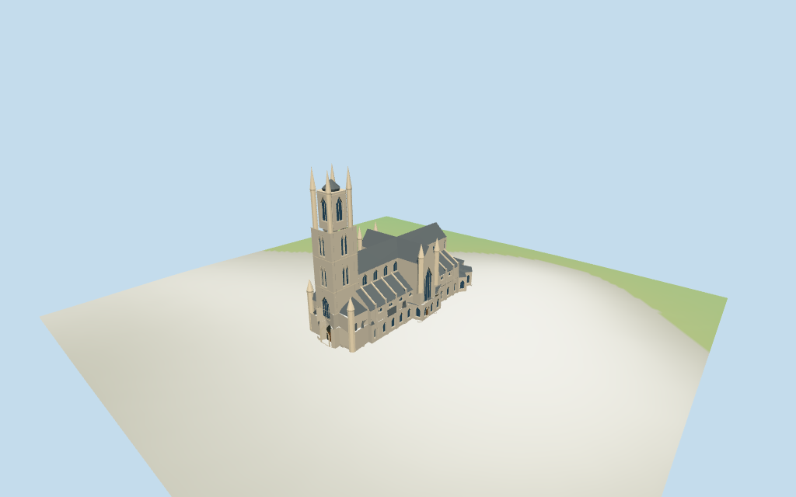

# N0370 — St Bavo's Cathedral review

Reviewed 2026-10-15 against current source/runtime bytes. Accepted for the medium-fi exterior and approximate geographic/terrain scope.

## Built result

Inspected all11 current portable/source-terrain frames. St Bavo's Cathedral has a stepped pale stone west tower with deeply recessed pointed entry/dark vault/lower wood door, a large lower window, paired middle lancets and tall upper field. Four corner pinnacles reach89m above a smaller83m dark central crown; no long central needle. Slate nave/round-ended choir, tall transept/four46m turrets, lean aisles, two small29m western stair turrets, buttress/flying support rhythm and low irregular chapel ring retain the individual silhouette. Separated roof primitives from wall aperture clipping, raised clerestory fields above lean-roof joins, moved lower glazing to exposed chapel facades and omitted a bay occupied by the first north nave buttress. Detailed carving/inscriptions/parapet tracery and adjoining town excluded.

Medium-fi exterior from one June2025 western picture, one undated historical southeast architectural picture and current standard PMTiles/DEM only. The historical picture informs visible architectural proportions; current map and2025 west view control identity/placement/tower. Modern hidden chapel/roof details, north facade, fenestration subdivisions and entry levels remain approximations. Short upper aisle fields sit above attached low chapel roofs; low exterior chapel windows carry the lower facade rhythm. Glazing uses closed dark fields/geometric bars and the main doorway has a dark vault/lower wood door. Exact sculpture/carvings/inscriptions, stained-glass art, tiniest tracery/parapets, town/roof furniture, full interiors/crypt, surveyed paving/steps and certified walking excluded. Physical laptop/phone timing pending.

## Shared materials and placement

Inspected all11 current shared/geographic frames. Four existing cached256-square ashlar, limestone, slate and plain wood graphs serve six merged groups, with pale stone/slate linear tints, metric UVs and flat architectural normals. Window/vault fields use geometric flat PBR colors. No embedded images, bespoke facade maps or baked shadows. Each graph reads once. Unload disposes geometry, leaves zero live model geometries and restores ground. Signed top placement follows the mapped footprint and specific tower/choir/transept controls. Below-datum footings/estimated portal can be partly masked by flat diagnostic ground; source-terrain views show approximate contact. Detail views intentionally crop portions; the four whole-model views include complete89m pinnacles.

Exact-QID way105192350/Q938154 matches current main35184477281182. All22 raw main/part outlines/tags and absent min_height values remain exact after rigid rotation, without rescale. Anchor[3.727188581,51.052981822], heading-0.24618519330162225rad follows the southern high-nave edge, signed by western tower/portal and round eastern choir. Four main corner pinnacle controls89m agree with retained89m fact. Other whole component envelopes remain lower tower60m, upper78m/crown83m, high nave/apse/transept43m, transept turrets46m, aisles/west chapels26m and western turrets29m. Main14m is interpreted as low chapel envelope. These are not stacked solids: estimated high eaves34/ridges43m, aisle walls18/roof joins26m, low eaves10/roofs14m, west shaft18..60/core60..78/crown78..83m with corner shafts to78/cones89m, front shafts22/cones29m and transept shafts38/cones46m subdivide the controls. Boolean inputs round0.1mm; joined layers, high union and low/aisle roof differences reproduce. Render shells simplify tiny mapped notches while detailed foundations retain raw main footprint. All156 viewer footprint checks cover22 controls while preserving three nearby buildings and a west-front patch across six outputs. Standard DEM datum17.738603m, floor offset0.4m, perimeter-1.01..0.51m. Side foundations follow terrain; main doorway uses local DEM+0.22m, secondary doors floor+0.2m. Exact Sint-Baafsplein paving, steps/ramps/thresholds, absolute altitude/cut-fill and walking unverified. No global flattening or road replacement.

Inspected all27 current Earth-lighting frames: Economy/High, noon/late, three distances, silhouette, six detail crops, four matched whole-model LODs and four transitions. Skyline keeps stepped tower, four tall pinnacles/smaller crown, nave/choir/aisle roofs, front/transept turrets and low chapel ring. District adds shared surfaces, flat pointed fields and support rhythm. Street adds actual portal/facade recesses, large mullions and coarse flying supports. Closeup/master refine nested entrance surrounds, geometric tracery and pinnacle bands. All matched whole-model cameras include the entire church and89m tips. Synthetic cottage context and ground bands are review fixtures. Stone carving, actual stained glass and modern hidden chapel/roof details remain simplified or unverified.

## Browser budgets

| Level | Triangles | Bytes | Draws |
| --- | ---: | ---: | ---: |
| skyline | 754 | 77200 | 1 |
| district | 2894 | 235824 | 6 |
| street | 9473 | 801452 | 6 |
| closeup | 10793 | 922564 | 6 |

Initial skyline plus district: **313024 bytes** of geometry. Master: **1298772 bytes / 10793 triangles**. Four cached shared 256² graphs, zero embedded images. Geometry bytes exclude graph definitions/texture generation. Split POSITION/NORMAL streams with equal CPU/GPU totals. Physical device timing pending.

## Verification

- Targeted byte reproduction, source/import/LOD/input/review hashes, recipe index and source inventory/schema match.
- Six Khronos validations: zero errors/warnings/images; four browser budgets pass.
- 22 raw main/part controls, complete height tags/absent min_height, signed frame, Boolean partitions, estimated subdivisions and standard DEM match.
- **1768 geometry probes** and **156 actual viewer footprint checks** pass.
- Shared graph read-once/unload and hash-bound placement/medium-fi reviews pass.
- Scene validation and 30-tick simulation pass: sha256:1f013fb286389e10db9ee98053715085bc2fa4403cf6f2e9f91b7d88a3a96452.
- Inspected **49 current frames**: 11 portable, 11 shared/placement, 27 medium-fi. Cameras/paths/hashes retained; bulk images ignored.

Source hash:sha256:b800e2fe7ff3fa590938661015315261ff7443b354f317c0fa437080349f9664. Runtime hash:sha256:3a263014dc73e60ff17d4fb51a160db4d4ce25568d4b0dbb2cb55d5d50659ec5. Input hash:sha256:e903a049fcf935176d4223e9ed424d29f377df2d7f6cf822dddc409fe1ecbe48.

Commands: targeted generate/import/LOD/register-landmark-previews --ids=N0370; generate-additional-landmarks.mjs --ids=N0370 --check; capture-next-1000-models.mjs --ids=N0370 --reflections --antialias --fit-shadows; capture-landmark-library.mjs --ids=N0370 --reflections --adaptive-clipping --bounded-placement; capture-medium-fi.mjs --ids=n0370_st_bavo_s_cathedral --reflections; molen validate; molen sim run --ticks 30 --hash. Routine full source checkpoint covers N0360–N0379.

## Limits

- Exact-QID way105192350/Q938154 matches current main35184477281182. All22 raw main/part plans/tags, including absent min_height, remain intact. Retained89m fact agrees with four main tower corner pinnacle controls89m; central upper core78m/crown83m, broad lower tower60m, nave/round choir/transept43m, four transept turrets46m, aisles/west chapels26m and two front turrets29m are whole component envelopes, not stacked wall solids. Main14m is interpreted as the low surrounding chapel envelope. Picture estimates subdivide these: high eaves34m/ridges43m, aisle walls18m/roof joins26m, low chapel eaves10m/roofs14m, west shaft18..60m plus upper core60..78m, crown roof78..83m, corner shafts to78m/cones89m, transept turret shafts38m/cones46m and front turret shafts22m/cones29m. Derived Boolean inputs round0.1mm; raw geometry rotates rigidly with no rescale. Entry, fenestration, turret subdivisions and modern hidden roof/chapel details are approximate.
- Standard viewer DEM datum 17.738603m; display offset 0.4m, raw mapped perimeter terrain -1.01..0.51m. Side foundations follow coarse viewer terrain; estimated main portal uses local DEM+0.22m and secondary doors use floor+0.2m. Exact Sint-Baafsplein paving, steps/ramps/thresholds, absolute altitude and walking remain unverified. No global flattening or road replacement.
- Medium-fi exterior from June2025 western picture, one undated historical southeast architectural picture and current standard PMTiles/DEM only. The old picture is used solely for visible building proportions; modern hidden roofs/chapels, north fenestration and doorway/paving levels remain approximate. Fine stone carving/sculpture/inscriptions, exact stained glass/tracery/parapets, town/roof furniture, full interiors/crypt and certified walking excluded. Tower glazing uses closed dark panels; the entrance has a dark vault backing and lower wood door. Physical device timing pending.
- Skyline preserves roof/chapel forms, stepped tower/four corner pinnacles, smaller central crown and front/transept turrets. District adds shared surfaces, flat pointed fields and support rhythm. Street opens facade/portal recesses with mullions and coarse flying supports; closeup/master refine nested entrance surrounds, tracery and pinnacle bands. Synthetic cottage context is a review fixture.

Readiness accepts this exterior scope. The 1,000-candidate goal remains incomplete.
