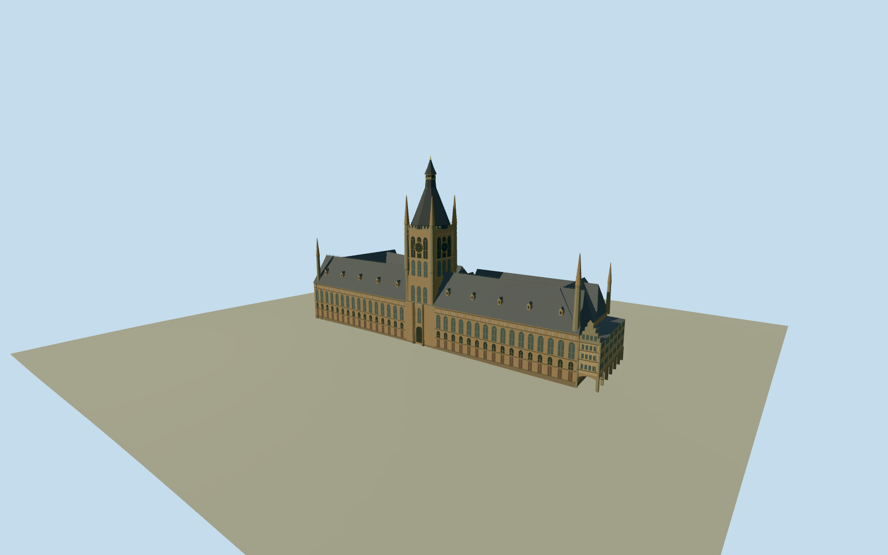

# Ypres Cloth Hall

The reconstructed Ypres Cloth Hall with the market belfry, two open courts, Gothic sandstone ranges and attached Renaissance Nieuwerck.

Authoring state: **review-in-qa.json**. Current completion evidence is in [qa.json](qa.json) and the [completion ledger](../../../../qualla-structures/batches/qualla-004.PROGRESS.md).

- [Ypres Cloth Hall](https://qualla.com/ypres-cloth-hall/)

The original view and heritage description establish the market elevation, while smaller roof and courtyard details are approximated.

The adjacent cathedral and surrounding market buildings are outside the modeled building scope.

Build: `node content/worldgen/source/places/u1/u14/ypres_cloth_hall/models/generate-ypres-cloth-hall.mjs`. Add `--check` to verify exact regeneration. 16368 triangles; 7 materials; no embedded photographs.
