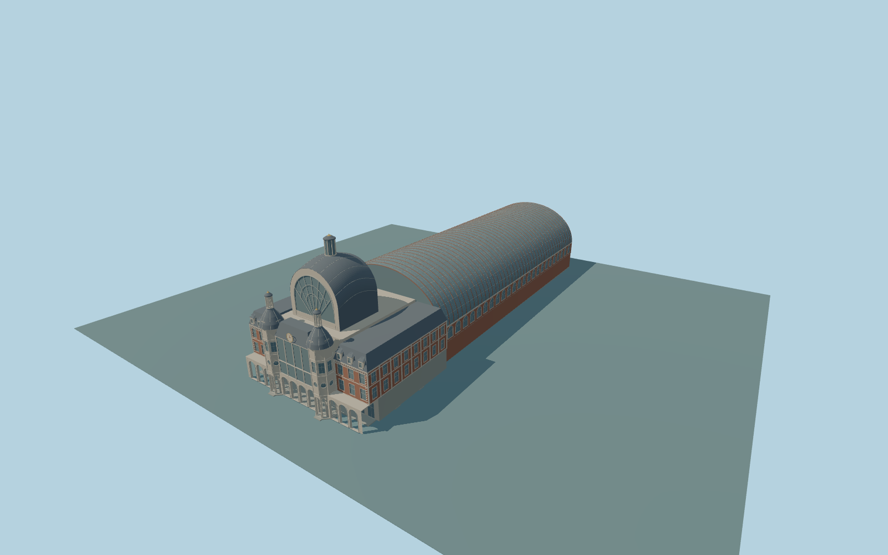

# Antwerp-Central railway station

Complete historic passenger headhouse plus connected 187m barrel-vaulted train shed. Whole 253m parent plan. Include side wings and mansards, two faceted pavilions with domes and pierced lanterns, glazed entrance screen and clock, large arched fanlight and domed central hall/lantern, real open street-level entrance arcades, and shed roof/end/side framing. Original approximate ornament and hidden windows; no logos, copied sculptures, navigable interior or train stock. Southern platform extensions and modern canopies remain native.

Rebuild: `node packages/worldgen/scripts/generate-antwerp-central-railway-station.mjs`;append `--check` for exact source bytes. Select import/LOD/placement with `--ids=antwerp_central_railway_station`. Detailed source and four browser tiers are separate ignored GLB outputs.

Complete historic passenger headhouse plus connected 187m barrel-vaulted train shed. Whole 253m parent plan. Include side wings and mansards, two faceted pavilions with domes and pierced lanterns, glazed entrance screen and clock, large arched fanlight and domed central hall/lantern, real open street-level entrance arcades, and shed roof/end/side framing. Original approximate ornament and hidden windows; no logos, copied sculptures, navigable interior or train stock. Southern platform extensions and modern canopies remain native.

The 253.18 by 78.4m historic parent and its native height parts control the extent: 35m passenger body, 43m pavilion roofs with 52m lantern tips, 65m central dome with 75m lantern tip, and 49m train-shed crown. Source preserves these distinct height facts as approximate geometry, not surveyed dimensions. Side wings have 28m cornices and closed 35m mansards; a tall glazed north entrance and arched fanlight stand in front of the central hall. One common unmodified field sample [0,133], 13.000847499999999m, supplies the floor datum. Whole occupied parent floor +0.35m with support to -3m; approximate elevated train deck +12m. Exact historic street, platform, dome profile and hidden roof joins remain approximate.

Two actual photographs establish whole historic headhouse and rear shed silhouette, with detailed north front. Unseen side/rear opening inventory and roof joins are original medium-fi approximations. Exact historic thresholds, ornament and numerical LOD errors remain unmeasured. Native terrain contact requires current render inspection. No copied lettering, crest, sculptural likeness or navigable interior. Rail approaches, southern platform extensions, modern entrance canopies and independent hotels/zoo remain native. Numerical LOD errors and physical-device timings remain unmeasured.

Six existing shared 256px limestone, brick, granite, slate, painted-metal and punched-window graphs; six groups maximum. Metric UVs and linear colors, no embedded or private images. Skyline keeps the full connected plan, open coarse arcade and lantern silhouettes, with thin post plates and flat window bands. District adds individual opening patches and pavilion detail. Street adds real window recesses, shallow frames and shed ribs. Close-up refines curves, frames, ribs and original geometric ornament; master preserves finer curves separately.

Original geometry:repository license. Map:© OpenStreetMap contributors,ODbL-1.0;Protomaps. Standard terrain:terrain-grid.json. Ordinary pictures stay local and are not redistributed or used as textures. Current acceptance:qa.json.
