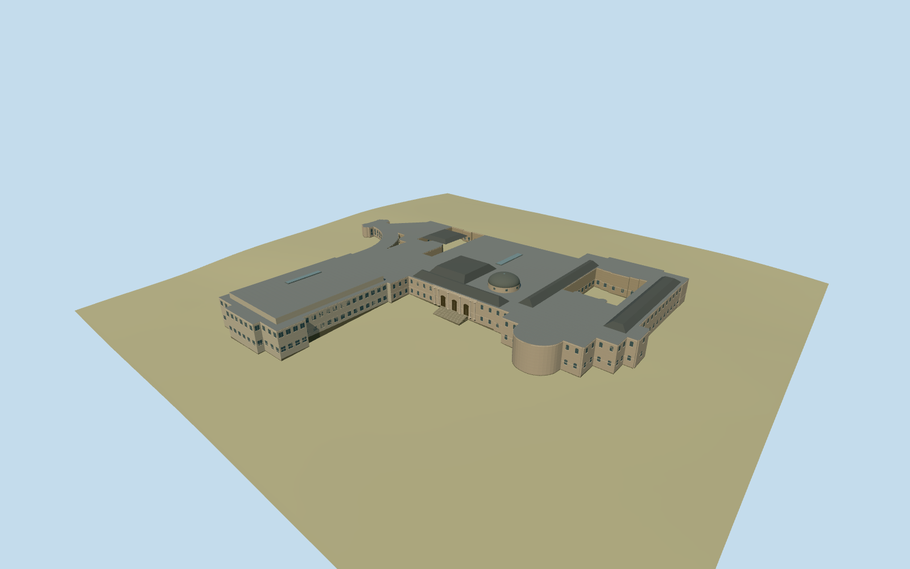

# Art & History Museum

The Brussels Cinquantenaire museum with its classical west entry, modern Antiquities Pavilion, rotunda and cloister courts.

Authoring state: **review-in-qa.json**. Current completion evidence is in [qa.json](qa.json) and the [completion ledger](../../../../qualla-structures/batches/qualla-003.PROGRESS.md).

- [Art & History Museum](https://qualla.com/art-history-museum/)

Exterior footprint and courtyard openings follow the native map. Roof elevations, dome projection, columns, masonry colours and window groupings are approximate architectural interpretations.

The adjoining Autoworld hall and its roof, the central triumphal arch, upper monumental colonnade, collection interiors and landscaping are outside this scope.

The entrance stairs and terrain contact follow the mapped entrance and regional open elevation data. Individual steps and paving are simplified.

Build: `node content/worldgen/source/places/u1/u15/art_and_history_museum/models/generate-art-and-history-museum.mjs`. Add `--check` to verify exact regeneration. 16875 triangles; 6 materials; no embedded photographs.
