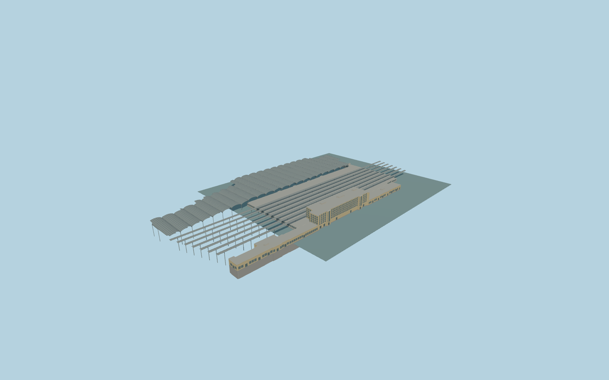

# Brussels-South railway station

Complete Brussels-South permanent passenger-station exterior: full yellow-brick Avenue Fonsny main office and recessed glazed stair bays, connected low southern and northern ranges, lower passenger concourse and service core, supported entrance canopy, complete mapped western transverse barrel/glazed roof field, and seven long open platform canopies. Preserve independent Pullman hotel,other offices and native rail/road infrastructure. No trains,brands,graffiti,temporary works,wire forests or navigable interiors.

Rebuild: `node packages/worldgen/scripts/generate-brussels-south-railway-station.mjs`;append `--check` for exact source bytes. Select import/LOD/placement with `--ids=brussels_south_railway_station`. Detailed source and four browser tiers are separate ignored GLB outputs.

Complete Brussels-South permanent passenger-station exterior: full yellow-brick Avenue Fonsny main office and recessed glazed stair bays, connected low southern and northern ranges, lower passenger concourse and service core, supported entrance canopy, complete mapped western transverse barrel/glazed roof field, and seven long open platform canopies. Preserve independent Pullman hotel,other offices and native rail/road infrastructure. No trains,brands,graffiti,temporary works,wire forests or navigable interiors.

Native5m concourse,8m western roof and23m main office remain recorded. Source office23m,connected low ranges9m,concourse roof5.5m,western barrel eaves8.3m/crowns11.5m and long canopy crowns10.6m are photograph-proportioned controls. Source roof services reach25m. Exact elevated track/platform levels are not surveyed. One unchanged standard host sample outside the Fonsny frontage,local[-70,105], 26.904193333333335m supplies one common datum. Level occupied floor+.85m and foundation/canopy support feet-10m. No per-part host offsets,track draping or artificial outside plaza. Native grades fall several metres toward Rue de France; exact urban contact must be inspected.

Two adequate ordinary exterior pictures inspected:2026 aerial and2016 Avenue Fonsny street view. Original medium-fi permanent exterior preserves the observed massing,brick frontage,glazed stair-bay character and roof families. Exact hidden opening inventory,canopy counts/profiles,service details and threshold levels are approximate. No extra bespoke sources used. The retained named station POI is an approximate physical match to mapped station roofs and Fonsny ranges; no exact Wikidata-tagged building identity is asserted. Western8m map part is interpreted as open platform roofing alongside the independent hotel,not a new hotel/office building. Seven longitudinal canopy groups and24 transverse barrel bays are original photo-proportioned roof families; exact track numbers,platform clearances,rail heights and present works remain unverified. Preserve all existing rails and transportation. Physical-device timings and numerical LOD errors remain unmeasured.

Seven existing shared256px brick,limestone,granite,membrane,painted-metal,window-grid andstorefront graphs;eight groups maximum because painted metal has separate roof and structural slots. MetricUVs,linear colors and no private or embedded images. Skyline retains the full station ranges,connected concourse,six coarse barrel groups andallseven longitudinal canopy groups. District restores24 barrel bays andcoarse regular glazing. Street addsrealwindowrecesses,roofribs,entranceportico andcladding bands. Close-up addsfullwindowinventory,frames,curvedstairglazing and finerroofribs/braces. Master preservesfinerroofcurvature separately.

Original geometry:repository license. Map:© OpenStreetMap contributors,ODbL-1.0;Protomaps. Standard terrain:terrain-grid.json. Ordinary pictures stay local and are not redistributed or used as textures. Current acceptance:qa.json.
