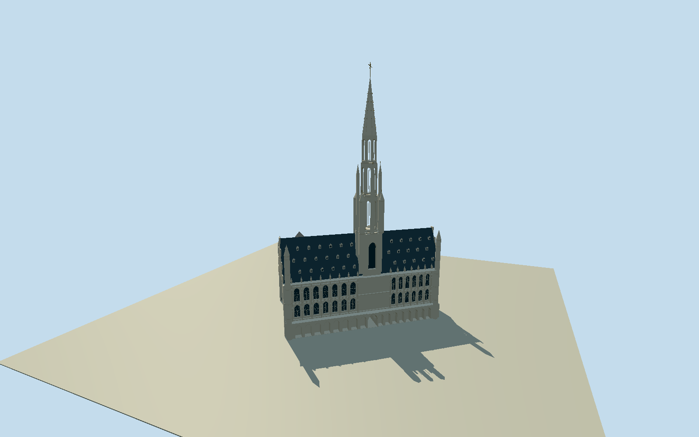

# Brussels Town Hall

Whole Brussels Town Hall: native Gothic front/side wings and intrinsic later rear wings around an open central courtyard, steep slate roofs/dense dormers/stepped side gables, off-center square tower/open octagonal belfry/turrets/tall slender spire/original simplified gilt finial, real ground-gallery/central-passage voids and deep pointed window reveals. Pale stone, original buttress/niche/balcony/tracery approximations, covered courtyard porticos. Exact native two-component built envelopes/all52ringvertices retained; property/GrandPlace/neighboring guild houses/signs/flags/people/interiors and copied detailed sculpture excluded.

Authoring state: **review-in-qa.json**. Current completion evidence is in [qa.json](qa.json) and the [completion ledger](../../../../qualla-structures/batches/qualla-002.PROGRESS.md).

- [Brussels Town Hall](https://qualla.com/brussels-town-hall/)

Whole built two-component footprint from native way1228487152(30controls) and23770973(22controls),52 ring vertices across the two components plus native overlapping tower/turrets/balconies/covered courtyard porticos retained separately. Identity amenity1126164595/Q1255327 and towerpart721672322/Q3996062 are correctly distinguished. Fixed common native bbox anchor/+Xeast/+Zsouth/heading0, not article reference coordinate. Both courtyard-facing concave building outlines remain actual physical envelopes; amenity/property is identity only, never a mass. Existing original native height/min_height/roof tags are preserved as metadata; no source floors/sections selected before field freeze.

All floor/section/geometry choices follow the frozen original500m129x12916641sample field/four rawtiles. Floor0 uses fixed SW29.6266m provider-relative datum, not a surveyed threshold. Actual native concave civic/rear envelopes/all52ringvertices and intrinsic native tower/turrets/portico plans retained; amenity/property including courtyard never extruded. Original photo-based Gothic20.6m eaves/35.4m steep dormered roof, rear11.8m eaves/5.4m rise,5.8m arcade, front0.5m window reveals/approximately2m ground gallery and3.9m central through-passage are bounded estimates. Preserved native tower37/52/62/92m tags inform original square base/octagonal stages37/50/62/72m/20m spire; original96.8m simplified gilt finial is an estimate, not surveyed/sculptural reproduction. Window/dormer/niche/ornament census, precise roof intersections, unseen courtyard/rear elevations/current finish are original bounded estimates. No terrain fit/flatten/reacquisition or subsequent raising to hide source contact. All geographic placement preview/replacementfalse, ground contact unresolved.

Three exact published Qualla creatorPD/CC0 originals individually inspected/nativeSHA1 matched:2025JulianLupyanCC0/own tower and two2011Kareljown/PD-self whole front/side views. No supplemental imagery/protected sources/copied pixels/textures/article-media-rightsmetadata repairs. Rear courtyard elevations/ornament/dormer-window census/roof intersections/hidden profile/current finish are original bounded estimates. Original gilt finial and niche/buttress mass simplify the architectural silhouette without copying the detailed figurative sculpture program. Distant levels reduce arch/dormer/turret/tracery census.

Independent500m129x12916641sample original field/fourrawtiles/fixed SW29.6266m provider datum frozen before floors/sections/geometry. No fit/flatten/reacquisition or subsequent raising to conceal contact. All geographic placement remains preview/replaceFootprint=false, exact grade/thresholds unresolved; flat isolated stage/neighborhood are synthetic review fixtures.

Build: `node content/worldgen/source/places/u1/u15/brussels_town_hall/models/generate-brussels-town-hall.mjs`. Add `--check` to verify exact regeneration. 25715 triangles; 5 materials; no embedded photographs.
