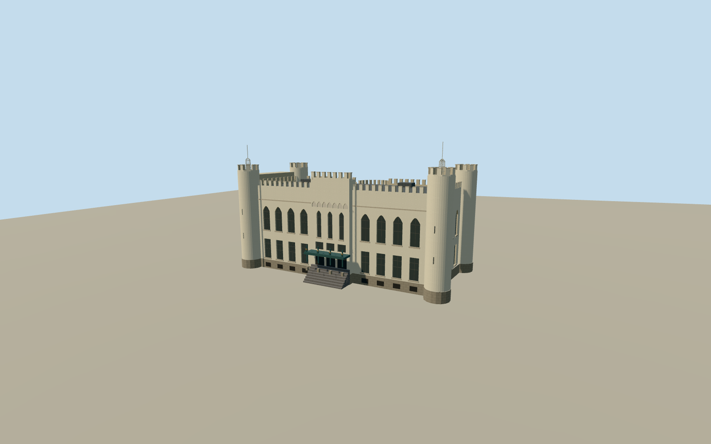

# City Hall of Tilburg

White crenellated former palace with round turrets, tall pointed windows and an Art Deco entrance canopy on Willemsplein.

Authoring state: **review-in-qa.json**. Current completion evidence is in [qa.json](qa.json) and the [completion ledger](../../../../qualla-structures/batches/qualla-003.PROGRESS.md).

- [City Hall of Tilburg](https://qualla.com/city-hall-of-tilburg/)

The two cleared Qualla photos control the west façade. Rear windows, parapet subdivision, lantern frames and roof equipment are interpreted from available evidence.

The national BAG/AHN main roof is approximately 15.15 m above the measured ground. The lidar data constrain massing and are not historic survey control.

This model depicts the palace building and its immediate connecting bay. The separate later civic-office complex lies outside its scope.

Terrain contact is approximate. Independent public elevation tiles were sampled before modeling and the source field is unchanged.

Reference photographs are retained in the Qualla corpus with their exact file hashes recorded here.

Build: `node content/worldgen/source/places/u1/u15/city_hall_of_tilburg/models/generate-tilburg-palace.mjs`. Add `--check` to verify exact regeneration. 11289 triangles; 5 materials; no embedded photographs.
