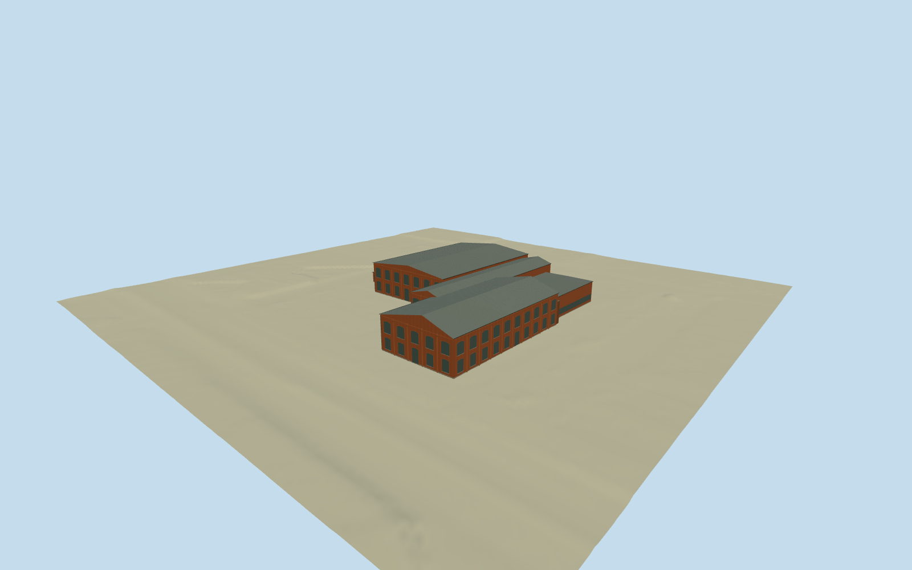

# De Zeeland Sugar Factory

The preserved De Zeeland sugar factory halls with industrial brick bays, stepped connections and shallow ridged metal roofs.

Authoring state: **review-in-qa.json**. Current completion evidence is in [qa.json](qa.json) and the [completion ledger](../../../../qualla-structures/batches/qualla-004.PROGRESS.md).

- [Sugar Factory Zeeland](https://qualla.com/sugar-factory-zeeland/)

The model depicts the standing factory halls and measured exterior volumes. Detailed current shopfront designs, signage, service fixtures and interiors are outside scope.

The cleared photograph predates the recent conversion. Historic façade openings are retained with representative reopened glazing, and shop entrances and unseen details use bounded estimates.

Build: `node content/worldgen/source/places/u1/u15/de_zeeland/models/generate-de-zeeland.mjs`. Add `--check` to verify exact regeneration. 8994 triangles; 4 materials; no embedded photographs.
