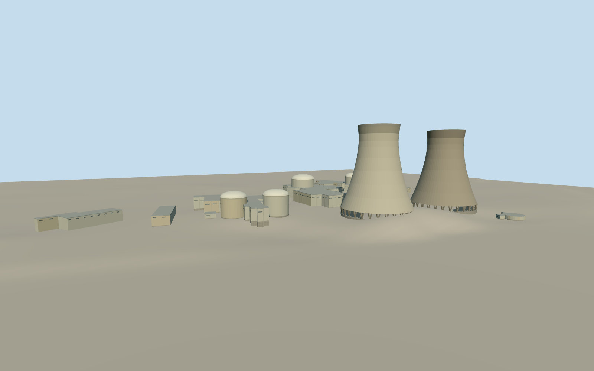

# Doel Nuclear Power Station

The two open-topped cooling towers at Doel rise above the concrete reactor domes and low industrial buildings on the west bank of the Scheldt.

Authoring state: **review-in-qa.json**. Current completion evidence is in [qa.json](qa.json) and the [completion ledger](../../../../qualla-structures/batches/qualla-003.PROGRESS.md).

- [Doel Nuclear Power Station](https://qualla.com/doel-nuclear-power-station/)

Standing industrial exterior with the twin natural-draft cooling towers, reactor hall massing and adjacent industrial halls. Machinery inside the plant, operational state and steam plumes are outside the model scope.

The native plans and mapped tower heights set the scale. Exact shell thickness, tower staining, support spacing, dome sections, roof equipment and secondary facade details are visual estimates.

The preserved composite elevation field retains its shore relief and local surface artifacts. Foundations transition into this field. The world placement follows its normal terrain provider, with fine grade approximate.

Build: `node content/worldgen/source/places/u1/u15/doel_nuclear_power_station/models/generate-doel.mjs`. Add `--check` to verify exact regeneration. 15222 triangles; 5 materials; no embedded photographs.
