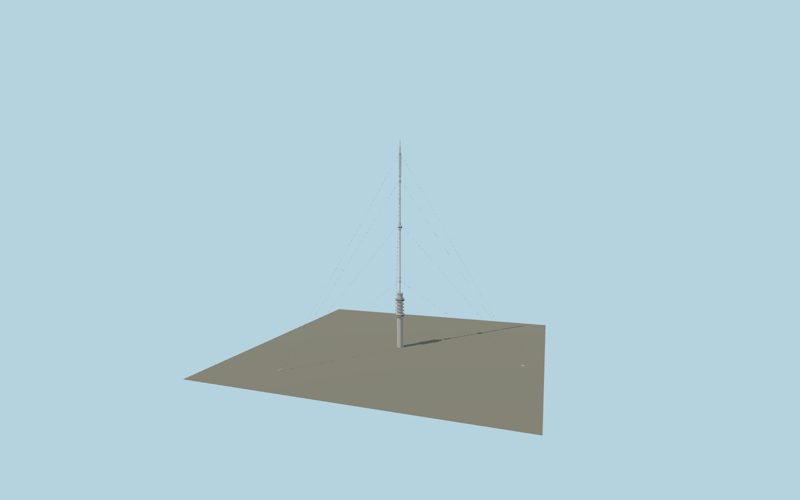

# Gerbrandy Tower

Current hybrid broadcast tower: 100 m concrete shaft, two glazed balcony rings, six open equipment galleries, 2 m steel pipe mast, reportage cabin, individual antenna arrays and twelve guys to the three mapped anchor blocks.

## Identity and geometry

Catalog gerbrandy_tower, [Q778390](https://www.wikidata.org/wiki/Q778390). Current owner Cellnex and fire-system installer Saval give 372 m total, approximately 100 m concrete and a 2 m diameter steel tube. RCE confirms the concrete shaft and two glazed balconies. Contemporary contractor photographs determine balcony rhythm, cabin, arrays and intermediate guy bands. Exact-QID OSM shaft and surveyed connected anchor-block footprints supply independent horizontal geometry.

Center of the exact-QID concrete shaft footprint, Y=0 at local terrain contact. +X east, +Z south; the three unequal mapped guy-anchor vectors determine site orientation; +Y is up. The geographic proposal identifies its anchor and orientation evidence separately from remaining terrain and azimuth uncertainty.

Source facts and measured references are recorded in spec.json. References: [1](https://www.cellnex.com/nl-nl/sections/locaties/), [2](https://www.saval.nl/cases/gerbrandytoren/), [3](https://www.volkerwessels.com/nl/projecten/gerbrandytoren), [4](https://zoek.officielebekendmakingen.nl/blg-216282.pdf), [5](https://monumentenregister.cultureelerfgoed.nl/monumenten/532229), [6](https://radiowereld.nl/medianieuws/2002/12/tuidraden-televisietoren-ijsselstein-vervangen/), [7](https://www.openstreetmap.org/way/54688034). Reference pages and images are not redistributed.

## Original source and shared materials

Geometry is authored in `packages/worldgen/scripts/gerbrandy-tower-model.mjs`. Shared material graphs with metric repeat UV0 and original vertex tints; GLB PBR fallback remains self-contained. No per-model texture duplication. No third-party mesh or photograph is embedded.

141,970 triangles; 269,236 vertices; 3 material groups; 11,398,488 source bytes. Source hash: `sha256:e99fc388a8d5e7f2f34586b2c20b45442a0257671fec3af4c55b583844b6c3c6`. Geometry validation checks finite Float32 coordinates, indices, triangle area and winding before export.

Regenerate with `node packages/worldgen/scripts/generate-heritage-towers.mjs gerbrandy_tower`; add `--check` for reproducibility. The generator refuses to overwrite a master whose hash differs from source.json. Import uses `--no-optimize` to preserve facade recesses.

## Remaining detail and review

- Retained372m envelope,100m shaft,2m pipe and mapped three-anchor topology govern the model. Alternate374/367m figures remain recorded in the detailed source. Balcony/equipment elevations, window phase and guy bands at122/302/350m remain photographic reconstruction;226m band and approximately220m cabin use retained published controls.
- All three foundations share the shaft terrain datum. Native polder grading/anchor contact has not been newly verified. Independent equipment buildings, below-ground works and seasonal Christmas strings remain outside this permanent tower asset.
- Detailed source equipment and dimensions are retained; inverted foundation winding and concrete/glazing clipping are corrected. Skyline aggregates window coverage and thin antenna/rail details; district uses sparse guards, seven aggregate racks and two-sided thin mast platforms. Street/closeup restore finer details; cable paths keep all12 connections with illustrative sag. No physical-device timing or engineering tension/collision certification.

Named near/far cameras are included for lit visual review. A valid export is not maximum-fidelity certification.
