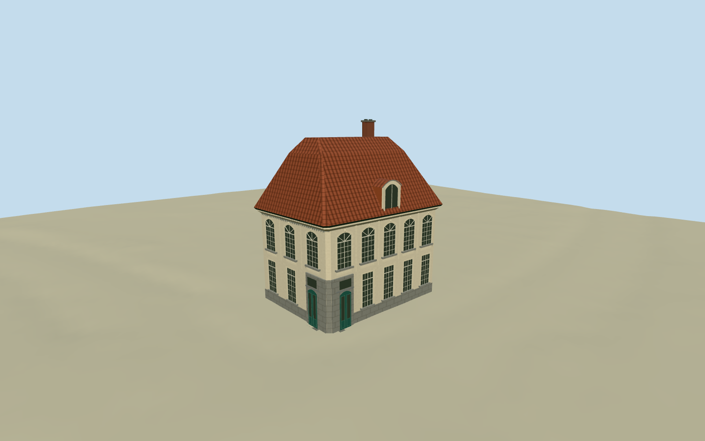

# Het Schipke

Het Schipke with its paired corner entrances, five Rococo bays and clay-tiled mansard.

Authoring state: **review-in-qa.json**. Current completion evidence is in [qa.json](qa.json) and the [completion ledger](../../../../qualla-structures/batches/qualla-004.PROGRESS.md).

- [Royal Carillon School "Jef Denyn"](https://qualla.com/royal-carillon-school-jef-denyn/)

This model depicts the former school’s documented corner house at number 63. The modern institution’s premises on Bruul and the neighboring Hof van Busleyden palace are separate.

Small openings, signwork and roof details outside the exact photo view use bounded estimates.

Build: `node content/worldgen/source/places/u1/u15/het_schipke/models/generate-het-schipke.mjs`. Add `--check` to verify exact regeneration. 1596 triangles; 6 materials; no embedded photographs.
