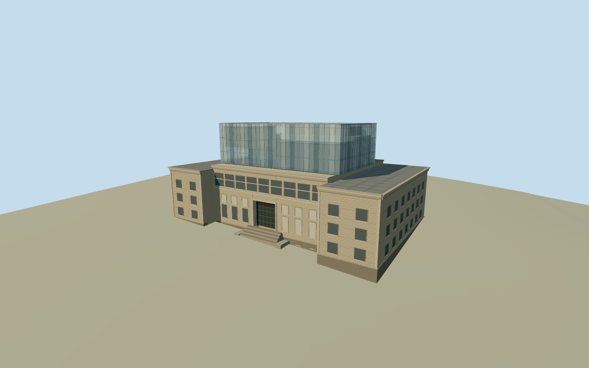

# House of European History

Pale limestone Eastman Building with symmetrical wings, sunken entrance and the museum’s translucent glass addition.

Authoring state: **review-in-qa.json**. Current completion evidence is in [qa.json](qa.json) and the [completion ledger](../../../../qualla-structures/batches/qualla-004.PROGRESS.md).

- [House of European History](https://qualla.com/house-of-european-history/)

The standing museum exterior retains the limestone shell and glass addition. The heights, opaque interior volumes’ exact positions behind the roof glass, rear window spacing and roof service forms are representative estimates.

The museum interior, courtyard exhibits, neighboring park and architectural signs at small scale are outside this model.

Build: `node content/worldgen/source/places/u1/u15/house_of_european_history/models/generate-house-of-european-history.mjs`. Add `--check` to verify exact regeneration. 7358 triangles; 8 materials; no embedded photographs.
